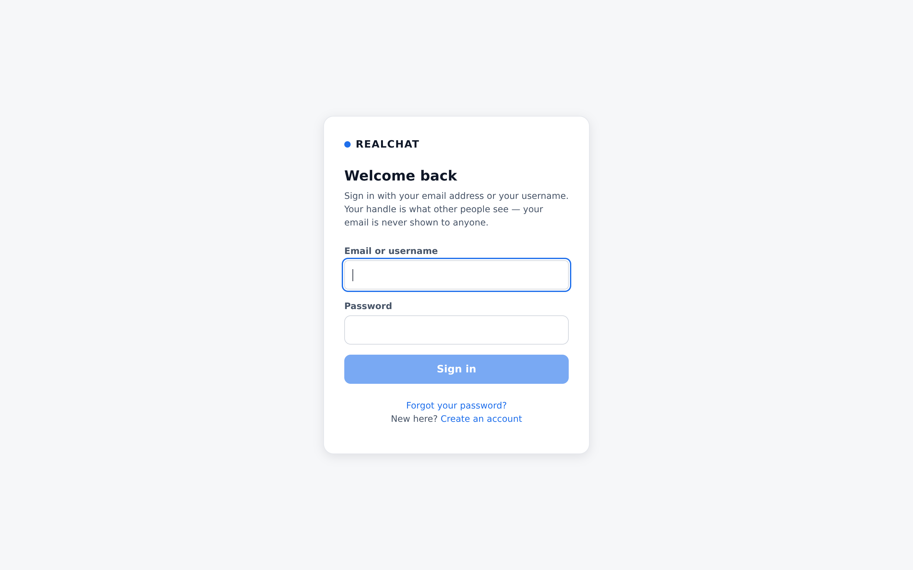
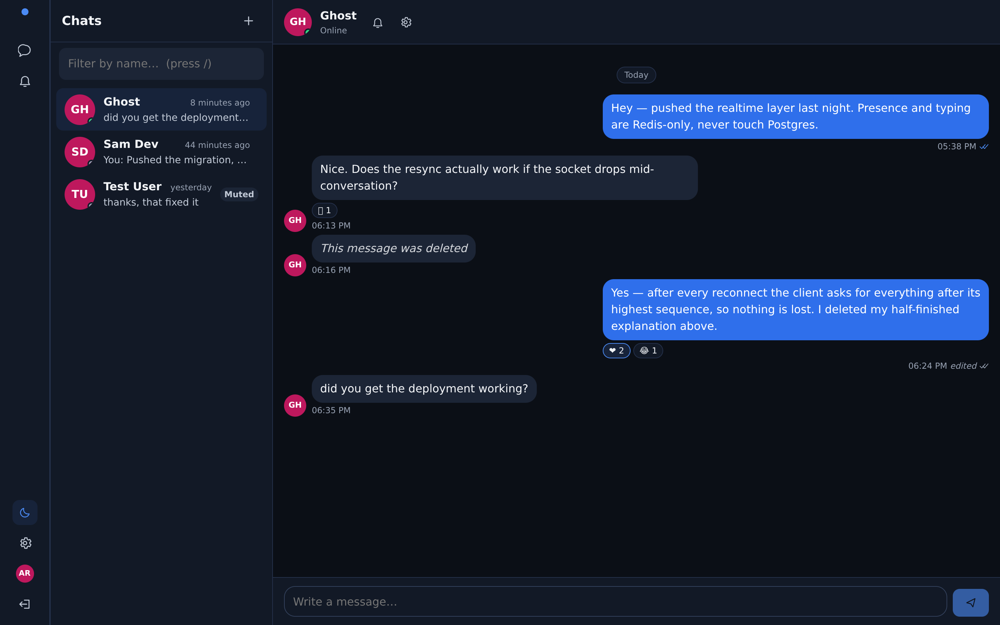
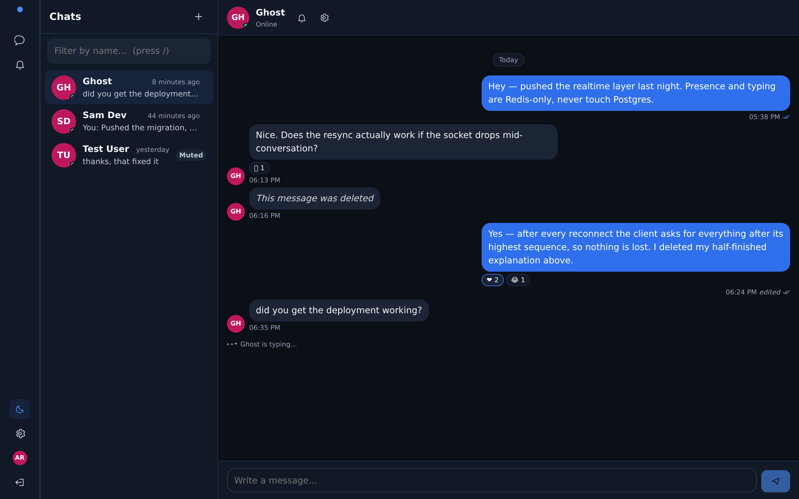
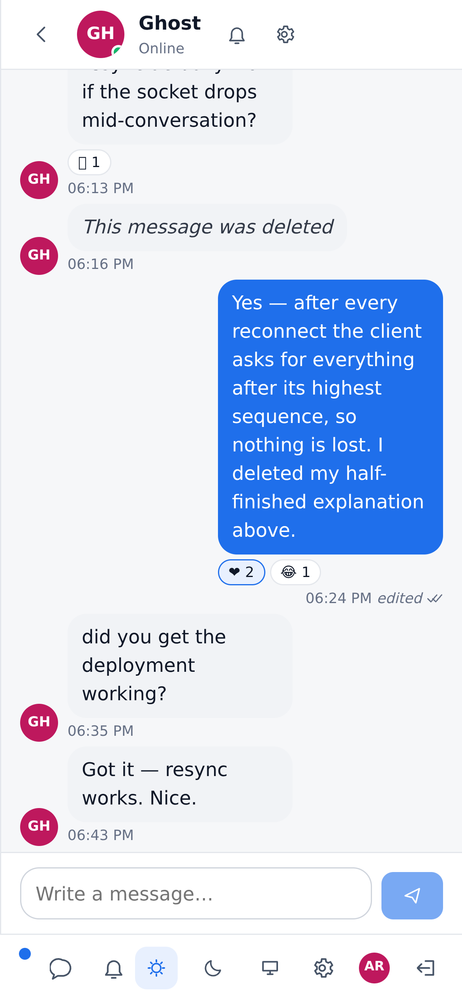

# REALCHAT

A real-time, pseudonymous chat application: register with a handle instead of an identity, find people
by username, hold a conversation, and see delivery and read state — without an email address or a photo
ever appearing on a profile.

Built as an "Industry Practice" project, engineered as a product: every non-obvious decision in the code
is written down, the schema is migration-managed, and the whole stack starts with one command.

---

## Stack

| Layer | Technology |
| --- | --- |
| Backend | Java 21, Spring Boot 3.5, Spring Web / Security / WebSocket, STOMP, Spring Data JPA + Hibernate, Bean Validation, Flyway, Maven |
| Data | PostgreSQL 16 (source of truth), Redis 7 (presence, typing, rate limits, session cache) |
| Frontend | JavaScript (no TypeScript), React 19, Vite, React Router, TanStack Query, Zustand, `@stomp/stompjs` |
| Edge | nginx (single origin: SPA + `/api` + `/ws`) |
| Tests | JUnit 5, Mockito, Testcontainers, Vitest, React Testing Library |
| Runtime | Docker Compose (postgres, redis, backend, frontend, nginx) |

Architecture is a **modular monolith**: one deployable, with feature modules under
`com.realtimechat.{auth, users, profiles, conversations, messaging, presence, notifications, moderation}`
that talk to each other through explicit service interfaces, never through each other's repositories.

---

## Quick start (Docker Compose)

**Every command for running, testing and operating the app lives in [RUNNING.md](RUNNING.md).** The
short version:

```bash
git clone https://github.com/anugrahyadav1594/upgraded-telegram.git
cd upgraded-telegram
cp .env.example .env                 # replace every CHANGE_ME value (see below)
docker compose -f infrastructure/docker-compose.yml --env-file .env up -d --build
open http://localhost:8080           # the SPA; /api and /ws are proxied to the backend
```

`--env-file .env` is explicit on purpose: with `-f` pointing at a compose file in another directory,
Compose resolves `.env` relative to that file, so being explicit makes the command work from the
repository root on every Compose version.

`SESSION_SECRET` and `POSTGRES_PASSWORD` must be set before the stack will start — the compose file
refuses to substitute placeholders, and the backend's production validator refuses to boot with them.
Generate a secret with `openssl rand -base64 48`.

Check it came up:

```bash
curl -fsS http://localhost:8080/actuator/health/readiness
docker compose -f infrastructure/docker-compose.yml ps
```

### Development accounts (optional, development only)

The seed creates `@alex`, `@ghost`, `@developer` and `@testuser` with clearly-marked `[DEV ACCOUNT]`
profiles. It requires an Argon2id hash — the seed contains no plaintext password, and refuses to run
without one:

```bash
# 1. Generate a hash from the backend image, using the same encoder that verifies logins.
docker compose -f infrastructure/docker-compose.yml --env-file .env \
  run --rm --entrypoint sh backend -c 'java -jar /app/app.jar --hash-password "$DEV_SEED_PASSWORD"'

# 2. Put the printed $argon2id$… string in .env as SEED_PASSWORD_HASH, then apply the seed.
docker compose -f infrastructure/docker-compose.yml --env-file .env --profile seed run --rm seed
```

`SEED_PASSWORD_HASH` is the Argon2id hash of `DEV_SEED_PASSWORD` — the hash goes in `.env`, the
plaintext is what you type at the sign-in screen. [RUNNING.md](RUNNING.md#a5-optional-the-development-accounts)
explains the format, why the seed refuses to run without it, and offers a ready-made development pair.

---

## Local development (hot reload)

```bash
docker compose -f infrastructure/docker-compose.yml --env-file .env up -d postgres redis

cd backend  && ./mvnw spring-boot:run        # http://localhost:8080  (profile: dev)
cd frontend && npm install && npm run dev    # http://localhost:5173  (proxies /api and /ws)
```

Note that Spring Boot does **not** read `.env` — export the credentials in your shell (or use the
throwaway containers documented in [RUNNING.md](RUNNING.md), which match the dev-profile defaults).

The Vite dev server proxies `/api` and `/ws` to the backend so the browser only ever sees one origin —
the same shape as production, which is what keeps the session cookie first-party and `SameSite=Lax`
valid during development instead of papering over a cross-origin cookie problem with CORS.

### See the interface without Java or Docker

The frontend only needs something that answers the documented API contract, so `tools/preview` is a
small stand-in server: it holds the same JSON shapes as the backend, broadcasts the same STOMP frames,
and accepts any credentials. Useful for looking at the UI, reviewing a design change, or capturing the
screenshots below — it is **development tooling and is never part of the application, the build or the
tests**.

```bash
node tools/preview/server.js                 # terminal 1 — stub API + realtime on :8080
cd frontend && npm install && npm run dev    # terminal 2 — the app on :5173
```

Sign in with anything (`alex` / `alex@example.test` are the fixture's names). Conversation changes can
even be pushed at it while the page is open:

```bash
curl -X POST http://localhost:8080/__preview/emit \
  -H 'Content-Type: application/json' \
  -d '{"type":"typing.started","payload":{"conversationId":"aaaaaaaa-aaaa-4aaa-8aaa-aaaaaaaaaaaa",
       "userId":"22222222-2222-4222-8222-222222222222","displayName":"Ghost","expiresInMs":6000}}'
```

### Tests and checks

```bash
cd backend  && ./mvnw verify                 # unit + integration (Testcontainers needs Docker)
cd frontend && npm run lint && npm test && npm run build

python3 tools/verify/sql_verify.py --execute            # schema + seed assertions against live PostgreSQL
python3 tools/verify/java_static_check.py --strict      # structural checks on the Java sources
```

---

## Screenshots

Captured from this codebase with `tools/preview/capture.mjs` ([what that means](docs/screenshots/README.md) —
the layout and behaviour are the real application, the messages are fixture data).

| Sign in | Conversation |
| --- | --- |
|  |  |
|  |  |

All sixteen are in [docs/screenshots/](docs/screenshots/): sign-in, registration, password reset, the
empty state, light and dark threads, a live typing indicator, notifications, settings, public profiles,
both mobile layouts, and the "can't reach the server" screen.

---

## Project layout

```
tools/preview/    development-only UI harness: stub API + realtime, and the screenshot capture
backend/          Spring Boot application (Java 21, Maven)
  src/main/java/com/realtimechat/{auth,users,profiles,conversations,messaging,presence,notifications,moderation,common,config}
  src/main/resources/db/migration/V1..V7   Flyway migrations (canonical copy)
frontend/         React SPA (Vite): api/, websocket/, state/, hooks/, components/, pages/, styles/
database/         migrations/ (mirror for infra tooling), seed/dev_seed.sql
docs/             11 documents — architecture through roadmap + websocket protocol
tests/            integration/, e2e/, performance/
infrastructure/   docker-compose.yml, docker/ (Dockerfiles), nginx/ (edge proxy)
tools/verify/     sql_verify.py, java_static_check.py (offline verification helpers)
```

---

## Documentation

| Document | What it answers |
| --- | --- |
| [architecture.md](docs/architecture.md) | Module boundaries, request flow, why a modular monolith |
| [requirements.md](docs/requirements.md) | Functional and non-functional requirements |
| [product-design.md](docs/product-design.md) | The product: pseudonymity, conversation model, reporting |
| [ux-design.md](docs/ux-design.md) | Flows, states, accessibility, responsive behaviour |
| [api-specification.md](docs/api-specification.md) | Every REST endpoint, payload and error |
| [database-design.md](docs/database-design.md) | Tables, indexes, constraints, retention |
| [websocket-protocol.md](docs/websocket-protocol.md) | Destinations, frames, reconnection and resync |
| [security-design.md](docs/security-design.md) | Threat model, sessions, CSRF, rate limits, hashing |
| [testing-strategy.md](docs/testing-strategy.md) | What is tested at which level, and why |
| [deployment.md](docs/deployment.md) | Compose, configuration, hardening, operations |
| [roadmap.md](docs/roadmap.md) | Deliberately unbuilt work: Kafka, search, E2EE |

---

## Security posture (summary)

- **Argon2id** password hashing; passwords are never logged, never stored reversibly.
- Sessions are **opaque server-side tokens** in `HttpOnly`, `SameSite` cookies — no token is ever
  reachable from JavaScript, and nothing sensitive is written to `localStorage`.
- **CSRF** double-submit on every unsafe method; WebSocket handshakes are origin-checked and
  authenticated by the same cookie.
- **Authorization is server-side and derived from the session.** `conversationId`, `messageId` and
  `userId` from a client are inputs to be verified, never trusted.
- **Blocking and reporting are enforced in the data path**: a block stops delivery, search visibility and
  new conversations; a report never notifies the reported account.
- Typing indicators and presence live in Redis with TTLs and are **never persisted** to PostgreSQL.
- Message history uses **cursor (keyset) pagination**; offsets are not used for large histories.
- Structured error responses (`{timestamp,status,code,message,path}`) with stack traces and internal
  details excluded from every client-visible path.

---

## Status

| Area | State |
| --- | --- |
| Documentation | Complete (11 documents) |
| Database | Complete: `V1`–`V7` + seed; verified against a live PostgreSQL 16 — **53/53 assertions pass** |
| Backend | Implemented: auth, users, profiles, conversations, messaging, presence, notifications, moderation (225 source files) |
| Frontend | Complete: build, lint and **25/25 tests pass**; the dev server serves the app |
| Infrastructure | Compose (5 services + seed profile), Dockerfiles, edge nginx |
| Tests | Frontend suites present and green; backend suites and the end-to-end scenario are the next milestone |

**Honest note on verification:** the authoring environment had no JDK, no Maven and no route to Maven
Central, so the backend has been verified structurally (`tools/verify/java_static_check.py`: parses,
package↔directory agreement, import resolution, entity↔migration column agreement) but **not compiled**.
Run `cd backend && ./mvnw verify` on a machine with a JDK to compile and test it; nothing in this
repository depends on the authoring environment. The database and frontend verifications above were
actually executed.

---

## Deliberately not built (see [roadmap.md](docs/roadmap.md))

Kafka event streaming, OpenSearch-backed search, microservice decomposition, and end-to-end encryption.
E2EE in particular is documented as roadmap work only — X3DH and the Double Ratchet are named so the
design direction is clear, and **no cryptography is invented or hand-rolled** anywhere in this codebase.

---

## License

[MIT](LICENSE)
