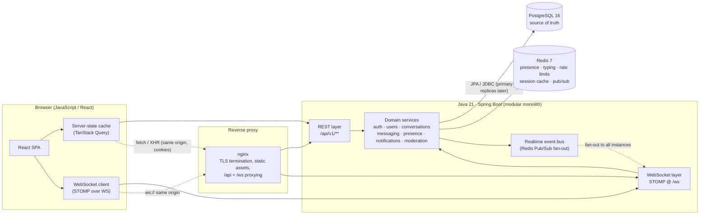
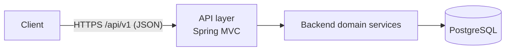
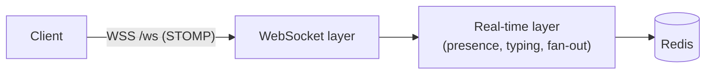
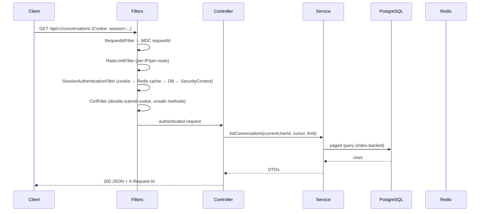
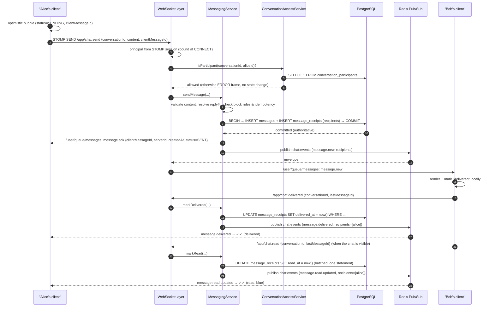
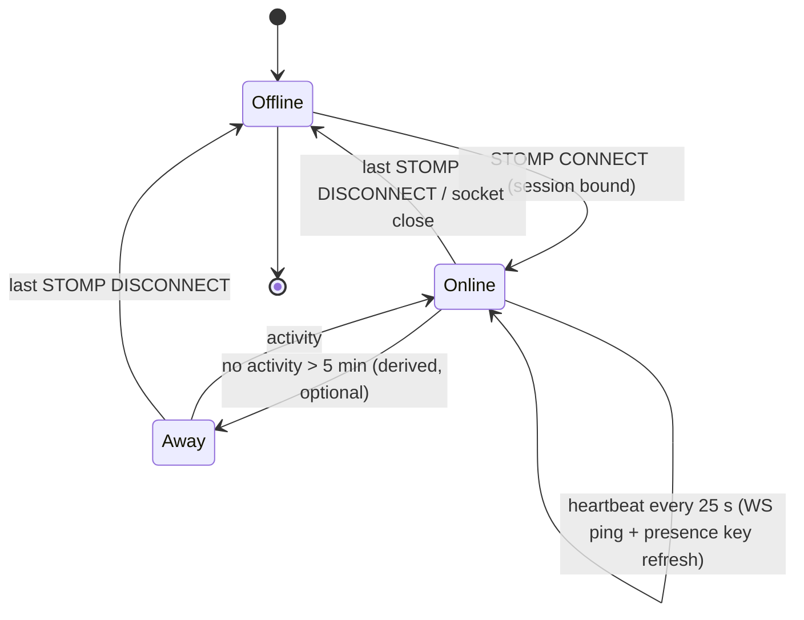
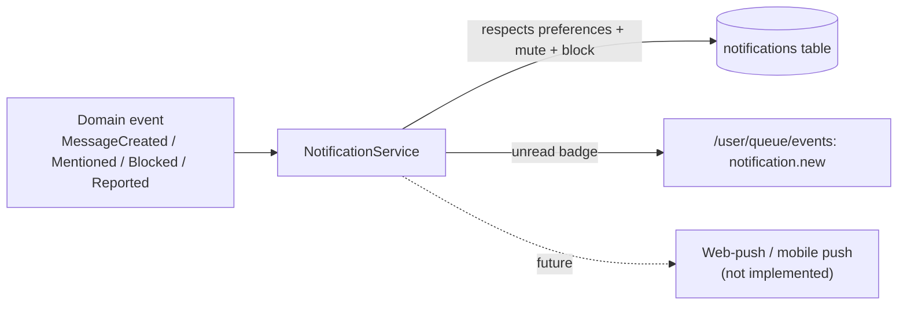
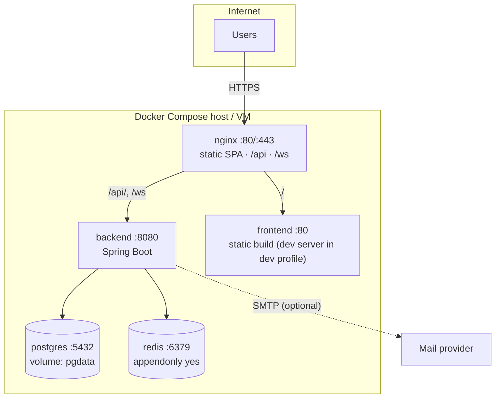

# Architecture

> Status: **authoritative**. This document describes the architecture that the code in `backend/`,
> `frontend/` and `database/` implements. Where the implementation deviates, the deviation is
> recorded in [§15 Deviations & known limitations](#15-deviations--known-limitations).

---

## 1. System overview

The product is a **pseudonymous real-time messaging platform**. Users authenticate with an email
address (private, never exposed to other users) and interact publicly through a pseudonymous
profile: `@username`, display name, avatar and bio.

The system is a **modular monolith** with two deployable units and three pieces of infrastructure:



Two diagrams are required explicitly by the specification:





The **complete message lifecycle** is documented in [§9](#9-message-lifecycle).

---

## 2. Architectural philosophy

| Principle | How it is applied here |
| --- | --- |
| **Modular monolith first** | One Spring Boot application, internally split into feature modules with package-private boundaries. No distributed transactions, no service-discovery, no network hops between modules. |
| **API-first** | `docs/api-specification.md` and `docs/websocket-protocol.md` are written before the code and are the contract. Controllers are thin adapters over that contract; OpenAPI is generated from the implementation so the two can be diffed. |
| **Single source of truth** | PostgreSQL is authoritative for *everything durable*: users, profiles, conversations, messages, receipts, blocks, reports, notifications. Redis holds only data that is allowed to disappear. |
| **Realtime ≠ persistence** | A WebSocket frame is a *hint*. If a frame is lost, the client re-synchronises from REST cursors. Nothing is considered "delivered" because a socket write succeeded. |
| **Security by default** | Deny by default in the security configuration, server-side authorization for every read and write, HttpOnly cookie sessions, Argon2id password hashing, Redis-backed rate limiting. |
| **Fail loudly, degrade gracefully** | Domain errors → typed exceptions → consistent JSON error contract. Infrastructure failures (Redis down) degrade specific features (presence unknown) instead of taking down messaging. |

---

## 3. Why a modular monolith (and when that changes)

**Decision.** Ship one Spring Boot process containing all domains.

*Rationale*

1. **Transactional integrity.** "Create message + receipts + conversation ordering" must be atomic.
   In a monolith this is one local transaction. As services it becomes a saga with compensating
   actions — infrastructure and complexity that an academic project cannot justify.
2. **Operational cost.** One JVM, one database, one cache: `docker compose up` yields a working
   system. A microservice split would need ≥5 processes plus a message broker for the same features.
3. **Team size.** One codebase that a single developer can run, test and reason about.
4. **Latency.** Chat fan-out is already I/O bound on Redis; an extra network hop between
   "messaging" and "conversations" would only add p99 latency.

*How modularity is preserved* (so that a split stays possible):

- **Feature-oriented packages** (`auth`, `users`, `profiles`, `conversations`, `messaging`,
  `presence`, `notifications`, `moderation`, `common`, `config`). No global `controller/`,
  `service/`, `repository/` dumping grounds.
- **Directional dependencies.** Cross-module calls go through a public service interface of the
  callee (`ConversationAccessService`, `UserLookupService`, `BlockQueryService`, `NotificationPublisher`).
  Modules never reach into another module's repositories or entities.
- **No shared entity graphs across modules.** `messaging` stores `conversation_id`/`sender_id` as
  identifiers; it does not map `Conversation` or `User` JPA relationships. This removes
  cross-module ORM coupling, which is exactly what breaks when you start splitting services.
- **Events, not calls, for side effects.** Notifications, presence broadcasts and receipt
  propagation are driven by domain events published after commit (`MessageCreatedEvent`,
  `MessageReadEvent`, `PresenceChangedEvent`, …). A future service can subscribe to the same events.
- **Transactional outbox boundary ready.** The event publisher API is `publishAfterCommit(...)`.
  Swapping the in-process dispatcher for an outbox table + relay is a localised change
  (see [roadmap.md](roadmap.md#3-event-bus-and-outbox)).

The full decomposition plan (API gateway, per-domain services, Kafka/OpenSearch/object storage) is in
[roadmap.md](roadmap.md#2-microservice-decomposition-path).

---

## 4. Frontend architecture

**React 19 + Vite + plain JavaScript (no TypeScript), component-based.**

```
frontend/src/
├── app/            App shell, router, providers
├── pages/          Route-level screens (thinnest possible: compose components + hooks)
├── layouts/        AuthLayout, AppLayout (3-column desktop / 2-pane mobile)
├── components/
│   ├── auth/       LoginForm, RegisterForm, ForgotPasswordForm, ResetPasswordForm
│   ├── chat/       MessageList, MessageBubble, MessageComposer, TypingIndicator, DayDivider
│   ├── conversation/ ConversationList, ConversationListItem, NewChatDialog, SearchResults
│   ├── profile/    ProfileHeader, ProfileDetails, AvatarPicker, BlockButton, ReportDialog
│   ├── settings/   PrivacySettings, NotificationSettings, AppearanceSettings, SessionList
│   └── common/     Button, Input, Modal, Spinner, EmptyState, ErrorState, Toast, Avatar, Badge
├── hooks/          useAuth, useConversations, useMessages, useTyping, usePresence, useTheme, …
├── services/       apiClient (fetch + CSRF + error mapping), one module per REST resource
├── websocket/      stompClient (connection state machine, exponential backoff, subscriptions)
├── state/          server state via TanStack Query; UI state via small Zustand slices
├── utils/          time formatting, avatar colours, validation, constants
└── styles/         design tokens (CSS variables), layout, component styles, themes
```

**Key decisions**

| Decision | Reason |
| --- | --- |
| **REST for durable data, WebSocket for realtime deltas** | History, search and pagination are query problems: REST + cursors handles them predictably (cacheable, retryable, testable). Sockets carry only low-latency deltas. |
| **TanStack Query for server state, Zustand for UI state** | Prevents the classic single-giant-store anti-pattern. Server data gets caching/invalidations for free; UI state (selected conversation, modals, theme, composer draft) stays local and serialisable. |
| **No auth token in `localStorage`** | Session lives in an `HttpOnly` `Secure` `SameSite=Lax` cookie. JS never sees the secret. CSRF token is a readable cookie echoed in a header (double-submit). |
| **Own STOMP client wrapper** | A single `stompClient` module owns: connection state machine (`CONNECTED`/`DISCONNECTED`/`RECONNECTING`/`FAILED`), exponential backoff with jitter, subscription registry that is re-established after reconnect, and a "resync after reconnect" hook that refetches conversations + the open conversation's latest page. |
| **Pure-CSS design system with tokens** | Light/dark/system theming through CSS custom properties; no runtime CSS-in-JS cost; respects `prefers-reduced-motion` and `prefers-color-scheme`. |

Realtime state that the UI derives but never persists: typing indicators (expire after 5 s),
presence, optimistic message status.

---

## 5. Backend architecture

```
backend/src/main/java/com/realtimechat/
├── RealtimeChatApplication.java
├── config/            SecurityConfig, WebSocketConfig, RedisConfig, JacksonConfig,
│                      OpenApiConfig, CorsProperties, AppProperties, MailConfig, WebMvcConfig,
│                      RateLimitProperties, ClockConfig
├── common/
│   ├── error/         ApiErrorResponse, ErrorCode, GlobalExceptionHandler, domain exceptions
│   ├── pagination/    Cursor, CursorCodec, PageResponse
│   ├── events/        DomainEvent, DomainEventPublisher, SpringDomainEventPublisher, RedisRealtimeBus
│   ├── ratelimit/     RateLimiter, RedisRateLimiter, @RateLimited aspect/interceptor
│   ├── validation/    @ValidUsername, @ValidDisplayName, @ValidMessageContent, validators
│   ├── web/           RequestIdFilter, ClientIpResolver, CurrentUserArgumentResolver? (no: explicit)
│   └── util/          Ids, TimeProvider, TextNormalizer, HashUtil
├── auth/              controller · service · repository · entity · dto · security · exception
├── users/             (identity: account + lookup API used by other modules)
├── profiles/          (public pseudonymous profile: username, display name, bio, avatar, search)
├── conversations/     (DIRECT now; GROUP/CHANNEL-ready model + access control service)
├── messaging/         (messages, receipts, reactions, attachments-ready, ws controller)
├── presence/          (Redis presence registry + WS lifecycle listeners)
├── notifications/     (notification records, preferences, ws delivery)
├── moderation/        (reports, moderation states, abuse hooks)
└── (resources) application.yml, db/migration/V*.sql, logback-spring.xml
```

**Layering rules** (enforced by review + ArchUnit-style tests in `backend/src/test/.../architecture`):

```
controller / ws-controller  →  service (interface + impl)  →  repository  →  entity
        ↘ dto ↙                        ↘ domain events ↙
```

- Controllers: HTTP/STOMP mapping, Bean Validation, DTO ↔ domain mapping. No business rules.
- Services: transaction boundaries (`@Transactional`), authorization checks, invariants, events.
- Repositories: Spring Data JPA; custom queries for cursor pagination and projections.
- Entities: never returned from controllers (DTOs only, so `email`/`passwordHash` cannot leak).

### Cross-cutting request flow



---

## 6. REST architecture

- **Base path** `/api/v1`; version is in the path because it is cache- and log-friendly and
  unambiguous for clients (see [api-specification.md](api-specification.md) for the full contract).
- **Resource-oriented** URLs; verb-free paths; `POST` only for non-idempotent creation and for
  explicit state transitions (`/messages/{id}/read`).
- **Cursor pagination everywhere** lists can grow: `?cursor=<opaque>&limit=` → `{ items, nextCursor, hasMore }`.
  Cursors are Base64URL-encoded `(sortKey, id)` pairs and are validated/decoded server-side.
  Never `OFFSET` beyond a first page for messages.
- **Status codes** are meaningful: `200`, `201` (+`Location` for created resources), `202`
  (accepted, e.g. password reset email), `204` (no body), `400`, `401`, `403`, `404`,
  `409` (conflict, e.g. username taken), `422` (semantic validation), `429` (rate limited).
- **Idempotency** for message send: `clientMessageId` (UUID) is unique per
  `(conversation_id, sender_id)`; re-sending the same id returns the previously stored message
  instead of duplicating it. This makes retry-after-reconnect safe.
- **Errors** use one shape for every failure (see [§11](#11-error-handling)).

---

## 7. WebSocket architecture

- **Transport**: native WebSocket at `/ws` (STOMP 1.2 frames). SockJS fallback is deliberately not
  enabled: all supported browsers have WebSocket, and SockJS adds an XHR fallback path that would
  need its own security review.
- **Authentication**: the handshake carries the same `HttpOnly` session cookie as REST. A
  `HandshakeInterceptor` resolves the session and rejects unauthenticated upgrades with `401`
  *before* any STOMP frame is accepted. The resolved principal is bound to the STOMP session in a
  `ChannelInterceptor` on `CONNECT`; every `@MessageMapping` handler re-checks authorization
  (the STOMP session principal is never trusted as proof of membership).
- **Destinations**

  | Kind | Destination | Notes |
  | --- | --- | --- |
  | App (client → server) | `/app/chat.send`, `/app/chat.read`, `/app/chat.delivered`, `/app/chat.typing`, `/app/message.edit`, `/app/message.delete`, `/app/message.reaction` | Validated + authorized per frame |
  | User (server → client) | `/user/queue/messages`, `/user/queue/events`, `/user/queue/errors` | Private to the STOMP session's identity |
  | Topic (server → subscribers) | `/topic/conversation/{conversationId}` | `SUBSCRIBE` is authorized against `conversation_participants` |

- **Fan-out**: the instance that accepted a frame persists first, then publishes to Redis
  Pub/Sub channel `chat:events`. Every instance (including the originator) receives the envelope and
  pushes to the local STOMP sessions of the addressed users. This keeps behaviour correct with N
  replicas behind a load balancer without sticky sessions for *delivery* (see
  [§13](#13-scalability-strategy)).
- **Ordering & loss**: STOMP over TCP preserves order per connection. Across reconnects, clients
  reconcile with REST (`GET /conversations/{id}/messages?cursor=latestKnown`). Sequence gaps in the
  client are handled by refetching the conversation page.

Full event catalogue, payload schemas, error frames and reconnection semantics:
[websocket-protocol.md](websocket-protocol.md).

---

## 8. Redis architecture

Redis is **ephemeral infrastructure**. Every key is namespaced, typed and TTL-bounded.

| Purpose | Key / channel | Type | TTL | Authoritative? |
| --- | --- | --- | --- | --- |
| Presence | `presence:{userId}` | Hash/string (`status`, `connections`, `lastSeenAt`) | 60 s (refreshed by heartbeat) | No — DB keeps `profiles.last_seen_at` only |
| Presence (per connection) | `presence:conn:{sessionId}` | String → `userId` | 60 s | No |
| Typing | `typing:{conversationId}:{userId}` | String | 5 s | **Never persisted** |
| Session cache | `session:{tokenHash}` | String → `userId` (+ session id) | 5 min | No — `user_sessions` is authoritative |
| Rate limiting | `rl:{bucket}:{key}` | Counter | window (e.g. 60 s) | No |
| Realtime fan-out | `chat:events`, `presence:events` (Pub/Sub) | — | — | No — messages live in PostgreSQL |
| Idempotency guard | `idem:msg:{conversationId}:{clientMessageId}` | String → messageId | 24 h | No — DB unique index is the guard |
| Short-lived caches | `cache:profile:{userId}` | String (JSON) | 30–60 s | No |

Rules:

1. **Never** the source of truth for anything a user must be able to read tomorrow.
2. **Never** used as message history (no Redis Streams as a message log).
3. Every write sets a TTL; a `RedisUnavailableException` in a non-critical path is logged and
   degraded (presence shows *unknown*, typing indicator simply does not appear), never a 5xx for
   sending a message.
4. Presence is *derived*, not stored per heartbeat: `lastSeenAt` is written to PostgreSQL only on
   the last connection close and at most once per 5 minutes per user.

---

## 9. PostgreSQL architecture

- **PostgreSQL 16+**, `UUID` primary keys (`gen_random_uuid()`), `timestamptz` for all instants
  (UTC), `text` with `CHECK` constraints for enumerations that must stay readable in SQL.
- **Flyway** owns the schema. Migrations are append-only; `spring.jpa.hibernate.ddl-auto=validate`
  so Hibernate can never silently change the schema.
- **Access paths drive indexes** — every index in [database-design.md](database-design.md#indexes)
  exists because a named query needs it; no speculative indexes.
- **Conversation identity for DIRECT chats** uses a deterministic `direct_key`
  (`least(userA,userB) || ':' || greatest(userA,userB)`) with a `UNIQUE` constraint. This makes
  "open a chat with this person" idempotent under concurrency — two simultaneous requests cannot
  create two conversations.
- **Unread counts** come from a partial index on `message_receipts (user_id) WHERE read_at IS NULL`
  and a `LEFT JOIN` in a single query per page — no per-row counting.
- **Soft delete** for messages (`deleted_at`) preserves thread integrity for replies while
  satisfying "delete for everyone"; hard delete is used for account deletion (GDPR-style erasure).

---

## 10. Authentication flow

```mermaid
sequenceDiagram
    autonumber
    participant B as Browser
    participant A as AuthController
    participant S as AuthService
    participant DB as PostgreSQL
    participant R as Redis

    B->>A: POST /auth/register {email, password, username, displayName}
    A->>S: register(...)
    S->>S: validate (Bean Validation + policy) & normalise email/username
    S->>S: hash password (Argon2id, per-password salt)
    S->>DB: INSERT users, profiles, privacy settings, notification settings (one tx)
    S->>S: create session token (256-bit random, stored as SHA-256 hash)
    S->>DB: INSERT user_sessions (id, token_hash, ip, user_agent, expires_at)
    S-->>B: 201 + Set-Cookie session=<token>; HttpOnly; Secure; SameSite=Lax; Path=/; Max-Age=...
    Note over B,R: [login] identifier(email or @username) + password → Argon2 verify →<br/>new session row; rotate token on privilege change; record last_login_at
```

- The **session token never reaches JavaScript**: it is `HttpOnly`. The complementary CSRF token is
  readable by JS by design (double-submit) and is useless without the session cookie.
- **Session rotation**: a fresh token is issued on login and on password change (which also revokes
  all other sessions). Sliding expiration: each authenticated request may extend `expires_at` at
  most once per hour, up to a 30-day absolute maximum from creation.
- **Logout** deletes the session row (and its Redis cache entry). **Logout-all** deletes every row
  for the user and publishes `session.revoked` so other tabs drop to the login screen immediately.
- **Password reset**: single-use, 30-minute token stored as a SHA-256 hash; consuming it revokes all
  sessions; the response for `POST /auth/forgot-password` is identical whether or not the email
  exists (no account enumeration).
- **Rate limiting** on `register`, `login`, `forgot-password`, `reset-password`, and per-IP request
  budgets via `RedisRateLimiter` (sliding window counters).

---

## 11. Message lifecycle

The full lifecycle, from optimistic UI to read receipts. **Nothing is broadcast before it is
committed.**



Guarantees and non-guarantees:

- **Durability**: once the commit returns, the message exists in PostgreSQL. A crash after commit
  and before fan-out loses *notification latency*, not the message: the recipient's next history
  load or reconnect resync shows it.
- **Exactly-once *effect*** via `clientMessageId` + unique index; the wire itself is at-most-once
  per attempt.
- **Ordering** is by `(created_at, id)` server-side; clients render in server order and reconcile
  optimistic messages by `clientMessageId`.
- **Edit/delete** are also persist-then-publish; edits carry `editedAt`, deletes are soft
  (`deleted_at`) and broadcast as `message.deleted` so all clients replace the bubble with
  "This message was deleted".
- There is **no end-to-end encryption** in this version; transport is TLS, storage is plaintext.
  E2EE is documented as future work in [roadmap.md](roadmap.md#6-end-to-end-encryption-roadmap) and
  no custom cryptography is invented anywhere.

---

## 12. Presence lifecycle



- Connection-scoped counts in Redis (`presence:conn:{sessionId}` → `userId`) make multi-tab correct:
  a user is offline only when the **last** connection disappears.
- `presence.updated` events are delivered to the user's *relevant contacts* only: participants of
  the user's conversations (computed from the DB, cached briefly). No global presence broadcast.
- `showOnlineStatus` / `showLastSeen` privacy settings are enforced **server-side** before any
  frame is emitted; a hidden user's contacts receive `presence.updated {status: "HIDDEN"}`.
- `last_seen_at` is persisted to `profiles` on last disconnect, throttled (≤1 write / 5 min / user),
  and only when `showLastSeen` is enabled.

---

## 13. Notification lifecycle



- In-app notifications are **persisted** (they survive refresh) and delivered in real time over the
  socket as a lightweight `notification.new` event.
- Notification creation is **asynchronous** (`@TransactionalEventListener(AFTER_COMMIT)` +
  `@Async` executor): a notification failure must never roll back or slow down message sending.
- Suppression rules (evaluated in order): user has notifications disabled → conversation muted →
  sender blocked → user is the sender → notification type disabled.
- `notifications` has `read_at`, a partial index for the unread badge, and a TTL policy
  (rows older than 90 days are pruned by a scheduled task — documented in
  [database-design.md](database-design.md#retention)).

---

## 14. Error handling

**REST** — one JSON shape for every error, produced by `GlobalExceptionHandler`:

```json
{
  "timestamp": "2026-09-22T10:41:07.812Z",
  "status": 400,
  "code": "INVALID_REQUEST",
  "message": "The request could not be processed",
  "path": "/api/v1/conversations",
  "requestId": "0f2a8b6e-...",
  "details": [{ "field": "content", "code": "SIZE", "message": "must be at most 4000 characters" }]
}
```

- Clients rely on `code` (stable) and `status`; `message` is human-readable and localisable later.
- Stack traces, SQL errors, vendor messages and internal paths are logged with the `requestId` and
  **never** returned. A catch-all handler maps unexpected exceptions to
  `500 { code: "INTERNAL_ERROR" }`.
- The `requestId` is echoed in the `X-Request-Id` response header and the log MDC, so a user-visible
  failure can be traced to a log line.

**WebSocket** — two mechanisms: domain-level failures are sent to `/user/queue/errors`
(correlated by `clientMessageId` when available) and the frame is dropped; protocol-level failures
produce a STOMP `ERROR` frame and a disconnect. Malformed frames never terminate the session unless
they are unparseable. Full table in [websocket-protocol.md](websocket-protocol.md#9-error-frames).

**Partial failure policy**

| Failure | Behaviour |
| --- | --- |
| Redis unavailable | Messaging still works on the local instance (fan-out falls back to local registry); presence/typing degrade; a warning is logged. |
| Database unavailable | Requests fail fast with `503 SERVICE_UNAVAILABLE`; WebSocket sessions stay open and clients see "reconnecting"; content is not accepted. |
| Slow subscriber | Bounded per-session send buffer; slow consumer is disconnected (`1008`) instead of blocking the fan-out thread. |

---

## 15. Scalability strategy

| Dimension | Approach |
| --- | --- |
| **Read scale** | Stateless REST instances behind a load balancer; PostgreSQL read replicas for history/search later; Redis cache for hot profiles. |
| **Write scale** | Messages are append-only and partitioned by `conversation_id`; the natural next step is declarative partitioning of `messages` by month plus archival to object storage. |
| **Fan-out** | Redis Pub/Sub to N instances; each instance pushes only to locally connected recipients. Presence events are targeted, not broadcast. |
| **Connection scale** | A dedicated WebSocket gateway + broker relay is the documented path (see roadmap). Today: `spring-boot-starter-websocket` with an application-level `SimpleBroker` (single instance) — the **only** single-instance component, and the first thing to externalise (RabbitMQ/ActiveMQ STOMP relay via `enableStompBrokerRelay`). |
| **Backpressure** | Bounded executor for async notification work; `spring.messaging` send buffer limits sized via config; slow sockets disconnected. |
| **Database hot spots** | Cursor pagination removes `OFFSET` scans; receipts are updated with bulk `UPDATE ... WHERE message_id IN (...)`; unread counts use a partial index. |
| **Search** | `pg_trgm` GIN indexes on `username`/`display_name` now; OpenSearch is the documented path when fuzzy ranking requirements grow. |

**Load test target** (see [testing-strategy.md](testing-strategy.md#performance-tests)):
2 000 WebSocket clients, 200 msg/s sustained, p95 end-to-end delivery < 300 ms on a 4 vCPU / 8 GB VM.

---

## 16. Deployment architecture



- Services address each other by **compose service name** (`postgres`, `redis`, `backend`), never
  `localhost`.
- Health checks: `pg_isready`, `redis-cli ping`, `GET /actuator/health`; `backend` waits for
  `postgres`/`redis` to be healthy (`depends_on: condition: service_healthy`).
- Configuration is entirely environment-driven (12-factor) — see [deployment.md](deployment.md).
- Dev/prod parity: the same image runs in both; only env vars and Spring profiles differ. TLS is
  terminated by nginx in this setup; a managed load balancer is the production equivalent.

Details, environment variables, migration procedure, backup/restore and production considerations:
[deployment.md](deployment.md).

---

## 17. Major architectural decisions (ADR summary)

| # | Decision | Status | Context | Consequences |
| --- | --- | --- | --- | --- |
| ADR-1 | Modular monolith, feature packages | accepted | Small team, needs transactions, must be runnable by a student or reviewer | Simple ops; requires discipline to keep module boundaries (checked by tests) |
| ADR-2 | PostgreSQL as single source of truth; Redis only ephemeral | accepted | Correctness of chat history is non-negotiable | Redis can be flushed without data loss; message reads always hit the DB (cache later if needed) |
| ADR-3 | Server-managed cookie sessions instead of JWT | accepted | XSS-token-theft resistance, revocability, "logout all devices" requirement | Needs CSRF protection and a stateful store; no cross-service token reuse (fine for a monolith) |
| ADR-4 | Argon2id password hashing via Spring Security's encoder + BouncyCastle | accepted | Requirement in the specification | Extra runtime dependency; tuned parameters (see security-design.md) |
| ADR-5 | STOMP over native WebSocket (no SockJS) | accepted | All target browsers support WS; simpler security surface | No legacy-browser fallback (acceptable) |
| ADR-6 | Redis Pub/Sub (not Kafka) for fan-out | accepted | Fan-out is lossy by nature; DB is the source of truth | At-most-once delivery of *hints*; Kafka is the documented upgrade when audit/replay is needed |
| ADR-7 | Cursor pagination with opaque cursors | accepted | `OFFSET` degrades on large histories and shifts under inserts | Slightly more code; stable, index-friendly reads |
| ADR-8 | Optimistic UI + `clientMessageId` idempotency | accepted | Perceived speed; socket retries must not duplicate | Unique index + upsert-or-return-existing logic |
| ADR-9 | Soft-delete messages; hard-delete accounts | accepted | Reply threads must remain coherent; privacy requires real erasure | Storage cost of tombstones; clear erasure path |
| ADR-10 | Spring Boot 3.5.x + Java 21 (not Boot 4.x) | accepted | Boot 4 moves to Jackson 3 (`tools.jackson`) and a restructured module layout; this project's verified toolchain is the 3.x line | Documented in [§18](#18-deviations--known-limitations) with an upgrade path |
| ADR-11 | Dev-only email transport logs the reset link | accepted | No fake emails, no hard-coded credentials | `app.mail.enabled=false` in dev; SMTP must be configured for production (fails fast on startup if missing in `prod`) |
| ADR-12 | Development seed data is opt-in (`dev` profile only) | accepted | "No mock data in production paths" | `dev_seed.sql` never runs in `prod`; accounts are clearly fake (`@example.test` emails, password from env) |

---

## 18. Deviations & known limitations

This section is intentionally honest — it is the current state, not the aspiration.

1. **Spring Boot 3.5.x instead of 4.x.** Verified against the upstream repositories:
   Spring Boot 4.1.1 restructures modules (`core/`, `starter/`, `module/`), defaults to Jackson 3
   (`tools.jackson.*`) and JUnit 6, and pairs with Spring Security 7. This implementation targets
   the 3.5.x line (latest patch `3.5.16`, Spring Framework 6.2, Jackson 2, Spring Security 6.5),
   which is the last line whose APIs are stable and widely documented. The DTO layer deliberately
   avoids Jackson-specific annotations so the Jackson 3 migration is a mechanical import change.
   Upgrade checklist is in [roadmap.md](roadmap.md#5-version-upgrade-path).
2. **Single-instance STOMP broker.** `SimpleBroker` does not share subscriptions between instances.
   Message *delivery* is correct across replicas (Redis fan-out decouples it), but broker-level
   topic subscriptions are per instance; the STOMP broker relay is the documented fix.
3. **No E2EE.** Transport encryption + server-side plaintext storage. Custom cryptography is
   explicitly out of scope; see [security-design.md](security-design.md#7-end-to-end-encryption-roadmap).
4. **Attachments are modelled, not enabled.** `message_type` supports `IMAGE`/`FILE` and the
   `attachments` table + validation rules exist, but there is no object-storage integration in this
   version; `TEXT` is fully implemented and `IMAGE`/`FILE` messages are rejected with
   `UNSUPPORTED_MESSAGE_TYPE` rather than silently accepted.
5. **Away/`AWAY` presence** is derived client-side (no activity for 5 minutes) and is not a
   server-enforced state.
6. **Email delivery** requires SMTP configuration; the dev transport writes the reset link to the
   application log. There is no fake in-memory mail sink in a production profile.
7. **In-sandbox verification limits.** The development environment used to author this repository
   had no access to Maven Central and no Docker daemon, so the Java module could not be compiled or
   executed here; it was verified by static analysis (`tools/verify/java_static_check.py`).
   The SQL migrations were executed against a real PostgreSQL instance and parsed with a
   PostgreSQL-lexer-accurate parser. The frontend was built and unit/integration tested for real
   (`npm run build`, `npm test`). See [testing-strategy.md](testing-strategy.md#what-was-verified-where)
   for exactly what was and was not executed.
