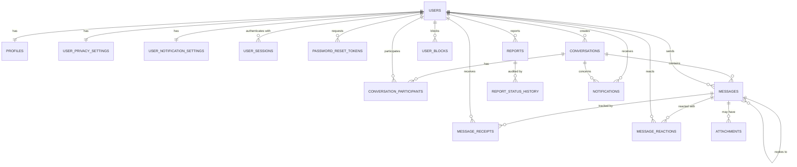

# Database Design

PostgreSQL 16+ · Flyway-managed · UUID primary keys · `timestamptz` (UTC) everywhere.

Migrations live in `backend/src/main/resources/db/migration` (the canonical location executed by
Spring Boot) and are mirrored in `database/migrations` for infrastructure tooling. Development seed
data is `database/seed/dev_seed.sql` (never run in production).

---

## 1. Entity-relationship overview



---

## 2. Identity & authentication

### `users`

| Column | Type | Notes |
| --- | --- | --- |
| `id` | `uuid` PK | `gen_random_uuid()` — never sequential, never reused |
| `email` | `citext`/`text` NOT NULL | stored lowercased; `UNIQUE` |
| `email_normalized` | generated: `lower(trim(email))` if `citext` unavailable | keeps case-insensitive uniqueness explicit |
| `password_hash` | `text` NOT NULL | Argon2id PHC string (`$argon2id$v=19$m=19456,t=2,p=1$…`) |
| `status` | `text` NOT NULL DEFAULT `'ACTIVE'` | `CHECK (status IN ('ACTIVE','SUSPENDED','DELETED'))` |
| `role` | `text` NOT NULL DEFAULT `'USER'` | `CHECK (role IN ('USER','ADMIN'))` |
| `email_verified` | `boolean` NOT NULL DEFAULT `false` | reserved for the verification flow |
| `failed_login_attempts` | `integer` NOT NULL DEFAULT 0 | reset on success |
| `locked_until` | `timestamptz` | soft lock after repeated failures |
| `last_login_at` | `timestamptz` | updated on successful login only |
| `created_at` / `updated_at` | `timestamptz` NOT NULL DEFAULT `now()` | `updated_at` maintained by trigger `set_updated_at()` |

Indexes: `UNIQUE (lower(email))`, `UNIQUE users_email_lower_uniq`, `INDEX (status) WHERE status <> 'ACTIVE'`.

### `profiles`

| Column | Type | Notes |
| --- | --- | --- |
| `user_id` | `uuid` PK | FK → `users(id)` ON DELETE CASCADE (1:1) |
| `username` | `text` NOT NULL | canonical lowercase; `UNIQUE` |
| `display_name` | `text` NOT NULL | 1–64 chars |
| `bio` | `text` | ≤ 280 chars (`CHECK (char_length(bio) <= 280)`) |
| `avatar_url` | `text` | `CHECK (avatar_url IS NULL OR avatar_url ~ '^https://')` |
| `username_public` | `boolean` NOT NULL DEFAULT true | gate for public responses |
| `last_seen_at` | `timestamptz` | written at most every 5 min per user (throttled in code) |
| `profile_completed_at` | `timestamptz` | null → onboarding incomplete |
| `created_at` / `updated_at` | `timestamptz` NOT NULL DEFAULT `now()` | |

Indexes: `UNIQUE (username)`, `INDEX (display_name text_pattern_ops)`, `GIN (display_name gin_trgm_ops)`,
`GIN (username gin_trgm_ops)` — the trigram indexes serve `ILIKE '%q%'` and name search.

Username policy (enforced in `UsernamePolicy`, mirrored by a `CHECK` constraint so the database
cannot hold an invalid handle):

```sql
CHECK (username ~ '^[a-z0-9](?:[a-z0-9_]{1,30})[a-z0-9]$')   -- 3..32 chars, no leading/trailing _
CHECK (username !~ '__')                                      -- no consecutive underscores
```

### `user_privacy_settings`

| Column | Type | Default | Meaning |
| --- | --- | --- | --- |
| `user_id` | `uuid` PK | | FK → `users` |
| `show_online_status` | `boolean` NOT NULL | `true` | presence hidden entirely when false |
| `show_last_seen` | `boolean` NOT NULL | `true` | required to also be false if online status is off |
| `show_profile_in_search` | `boolean` NOT NULL | `true` | excludes from `GET /users/search` |
| `allow_messages_from` | `text` NOT NULL | `'EVERYONE'` | `CHECK IN ('EVERYONE','CONTACTS')` |
| `read_receipts` | `boolean` NOT NULL | `true` | when false, reads are not broadcast |
| `created_at` / `updated_at` | `timestamptz` | `now()` | |

Constraint: `CHECK (show_online_status OR NOT show_last_seen)` — "online hidden implies last seen
hidden" is a database invariant, not just a service rule.

The model is extensible: new switches are added as columns with defaults; no enum table is needed
because each flag is independent.

### `user_sessions`

| Column | Type | Notes |
| --- | --- | --- |
| `id` | `uuid` PK | the identifier exposed to the user in "active sessions" |
| `user_id` | `uuid` NOT NULL | FK → `users` ON DELETE CASCADE |
| `token_hash` | `text` NOT NULL UNIQUE | SHA-256 of the 256-bit random token; the raw token exists only in the cookie |
| `ip_address` | `inet` | for abuse investigation; purged with the row |
| `user_agent` | `text` | truncated to 256 chars |
| `created_at` | `timestamptz` NOT NULL | |
| `last_used_at` | `timestamptz` NOT NULL | updated at most hourly (sliding expiration) |
| `expires_at` | `timestamptz` NOT NULL | `created_at + 30 days` absolute max (idle timeout 7 days applied in code) |
| `revoked_at` | `timestamptz` | null = active |

Indexes: `UNIQUE (token_hash)`, `INDEX (user_id) WHERE revoked_at IS NULL`, `INDEX (expires_at)` (cleanup job).

### `password_reset_tokens`

| Column | Type | Notes |
| --- | --- | --- |
| `id` | `uuid` PK | |
| `user_id` | `uuid` NOT NULL | FK → `users` ON DELETE CASCADE |
| `token_hash` | `text` NOT NULL UNIQUE | SHA-256; raw token only in the email link |
| `expires_at` | `timestamptz` NOT NULL | `now() + 30 min` |
| `consumed_at` | `timestamptz` | single-use |
| `created_at` | `timestamptz` NOT NULL | |

Index: `INDEX (user_id) WHERE consumed_at IS NULL`, `INDEX (expires_at)`.

---

## 3. Conversations & messaging

### `conversations`

| Column | Type | Notes |
| --- | --- | --- |
| `id` | `uuid` PK | |
| `type` | `text` NOT NULL DEFAULT `'DIRECT'` | `CHECK IN ('DIRECT','GROUP','CHANNEL')` — only `DIRECT` is produced today |
| `direct_key` | `text` UNIQUE | `least(a,b) || ':' || greatest(a,b)`; `NULL` for non-DIRECT |
| `title` | `text` | reserved for `GROUP` |
| `created_by` | `uuid` | FK → `users` |
| `last_message_id` | `uuid` | FK → `messages` (deferred/denormalised pointer for list ordering) |
| `last_activity_at` | `timestamptz` NOT NULL DEFAULT `now()` | drives list ordering |
| `created_at` / `updated_at` | `timestamptz` NOT NULL DEFAULT `now()` | |

Indexes: `UNIQUE (direct_key)` (partial: `WHERE direct_key IS NOT NULL`), `INDEX (last_activity_at DESC)`.

The `direct_key` unique index is what makes "start a chat with this person" idempotent under
concurrent requests: the second insert loses with a unique violation, which the service translates
into "fetch the existing conversation".

### `conversation_participants`

| Column | Type | Notes |
| --- | --- | --- |
| `conversation_id` | `uuid` NOT NULL | FK → `conversations` ON DELETE CASCADE |
| `user_id` | `uuid` NOT NULL | FK → `users` ON DELETE CASCADE |
| `joined_at` | `timestamptz` NOT NULL DEFAULT `now()` | |
| `last_read_message_id` | `uuid` | FK → `messages`; drives the unread badge |
| `last_read_at` | `timestamptz` | |
| `muted` | `boolean` NOT NULL DEFAULT false | suppresses notifications |
| `archived` | `boolean` NOT NULL DEFAULT false | hides from the default list |
| `deleted_at` | `timestamptz` | per-user removal ("delete conversation") |
| `created_at` / `updated_at` | `timestamptz` NOT NULL DEFAULT `now()` | |

Constraints: `PRIMARY KEY (conversation_id, user_id)`, `INDEX (user_id, deleted_at, archived)`,
`INDEX (conversation_id)`, partial `INDEX (user_id) WHERE deleted_at IS NULL`.

### `messages`

| Column | Type | Notes |
| --- | --- | --- |
| `id` | `uuid` PK | message id is also used as the pagination tiebreaker |
| `conversation_id` | `uuid` NOT NULL | FK → `conversations` ON DELETE CASCADE |
| `sender_id` | `uuid` NOT NULL | FK → `users`; set to the tombstone user on account deletion |
| `content` | `text` | `CHECK (content IS NULL OR char_length(content) BETWEEN 1 AND 4000)` |
| `message_type` | `text` NOT NULL DEFAULT `'TEXT'` | `CHECK IN ('TEXT','IMAGE','FILE','SYSTEM')` |
| `reply_to_message_id` | `uuid` | FK → `messages(id)` ON DELETE SET NULL |
| `client_message_id` | `uuid` | supplied by the client for idempotency |
| `sequence` | `bigint` | per-conversation monotonic counter (gap detection, resync) |
| `edited_at` | `timestamptz` | set on edit |
| `deleted_at` | `timestamptz` | soft delete; content nulled in the same transaction |
| `created_at` | `timestamptz` NOT NULL DEFAULT `now()` | server clock |
| `updated_at` | `timestamptz` NOT NULL DEFAULT `now()` | |

Constraints & indexes:

- `UNIQUE (conversation_id, sender_id, client_message_id)` — idempotent sends
- `INDEX (conversation_id, created_at DESC, id DESC)` — the history pagination access path
- `INDEX (sender_id, created_at DESC)` — "my messages" / moderation queries
- `INDEX (conversation_id, sequence)` — gap detection and resync
- `INDEX (reply_to_message_id)` — reply lookups

Design notes:

- **No `SELECT *` over an unbounded set**: every query is scoped by `conversation_id` and ordered by
  the composite index; pagination is `(created_at, id) < (cursor_ts, cursor_id)` — never `OFFSET`.
- `sequence` is assigned inside the message transaction (`UPDATE conversations SET last_sequence = …`)
  so gaps are detectable without scanning the table.
- `messages` is written once and updated rarely (edit/delete), which makes it a natural candidate for
  declarative partitioning by month at scale (see [architecture.md](architecture.md#15-scalability-strategy)).

### `message_receipts`

| Column | Type | Notes |
| --- | --- | --- |
| `message_id` | `uuid` NOT NULL | FK → `messages` ON DELETE CASCADE |
| `user_id` | `uuid` NOT NULL | FK → `users` ON DELETE CASCADE |
| `status` | `text` NOT NULL DEFAULT `'SENT'` | `CHECK IN ('SENT','DELIVERED','READ')` — monotonic |
| `delivered_at` | `timestamptz` | |
| `read_at` | `timestamptz` | |
| `created_at` / `updated_at` | `timestamptz` NOT NULL | |

Constraints: `PRIMARY KEY (message_id, user_id)`,
`INDEX (user_id, read_at) WHERE read_at IS NULL` (unread badge + unread counts),
`INDEX (message_id, status)`.

The **server** is authoritative: status changes are `UPDATE … SET status = 'DELIVERED' WHERE status = 'SENT'`,
so a stale/replayed acknowledgement can never move a receipt backwards.

### `message_reactions`

| Column | Type | Notes |
| --- | --- | --- |
| `message_id` | `uuid` NOT NULL | FK → `messages` ON DELETE CASCADE |
| `user_id` | `uuid` NOT NULL | FK → `users` ON DELETE CASCADE |
| `emoji` | `text` NOT NULL | restricted in code to a 32-emoji allow-list |
| `created_at` | `timestamptz` NOT NULL | |

Constraints: `PRIMARY KEY (message_id, user_id, emoji)`, `INDEX (message_id)`.

### `attachments` (modelled, not enabled in this release)

| Column | Type | Notes |
| --- | --- | --- |
| `id` | `uuid` PK | |
| `message_id` | `uuid` | FK → `messages` ON DELETE CASCADE |
| `uploader_id` | `uuid` NOT NULL | FK → `users` |
| `file_name` | `text` NOT NULL | sanitised (no path separators, ≤ 255 chars) |
| `content_type` | `text` NOT NULL | validated against an allow-list |
| `size_bytes` | `bigint` NOT NULL | `CHECK (size_bytes BETWEEN 1 AND 26214400)` (25 MB) |
| `storage_key` | `text` NOT NULL | object-storage key (never a local path) |
| `checksum_sha256` | `text` NOT NULL | integrity check |
| `created_at` | `timestamptz` NOT NULL | |

---

## 4. Safety & moderation

### `user_blocks`

| Column | Type | Notes |
| --- | --- | --- |
| `blocker_id` | `uuid` NOT NULL | FK → `users` ON DELETE CASCADE |
| `blocked_id` | `uuid` NOT NULL | FK → `users` ON DELETE CASCADE |
| `created_at` | `timestamptz` NOT NULL DEFAULT `now()` | |

Constraints: `PRIMARY KEY (blocker_id, blocked_id)`,
`CHECK (blocker_id <> blocked_id)`,
`INDEX (blocked_id)` (enforcement in the reverse direction).

### `reports`

| Column | Type | Notes |
| --- | --- | --- |
| `id` | `uuid` PK | |
| `reporter_id` | `uuid` NOT NULL | FK → `users` |
| `target_type` | `text` NOT NULL | `CHECK IN ('USER','MESSAGE')` |
| `target_user_id` | `uuid` | FK → `users` |
| `target_message_id` | `uuid` | FK → `messages` |
| `reason` | `text` NOT NULL | `CHECK IN ('SPAM','HARASSMENT','HATE_SPEECH','IMPERSONATION','SEXUAL_CONTENT','VIOLENCE','SELF_HARM','OTHER')` |
| `description` | `text` | ≤ 1000 chars |
| `status` | `text` NOT NULL DEFAULT `'OPEN'` | `CHECK IN ('OPEN','REVIEWING','RESOLVED','DISMISSED')` |
| `resolution_note` | `text` | admin-only |
| `reviewed_by` | `uuid` | FK → `users` |
| `reviewed_at` | `timestamptz` | |
| `created_at` / `updated_at` | `timestamptz` NOT NULL | |

Constraints: `CHECK ((target_type = 'USER' AND target_user_id IS NOT NULL) OR (target_type = 'MESSAGE' AND target_message_id IS NOT NULL))`,
partial unique `UNIQUE (reporter_id, target_user_id, target_message_id) WHERE status IN ('OPEN','REVIEWING')`
(prevents report spam of the same target), `INDEX (status, created_at)`, `INDEX (target_user_id)`.

### `report_status_history`

`id uuid PK`, `report_id uuid NOT NULL`, `from_status text`, `to_status text NOT NULL`,
`actor_id uuid`, `note text`, `created_at timestamptz NOT NULL`.
Index: `(report_id, created_at)`.

---

## 5. Notifications

### `notifications`

| Column | Type | Notes |
| --- | --- | --- |
| `id` | `uuid` PK | |
| `user_id` | `uuid` NOT NULL | recipient, FK → `users` ON DELETE CASCADE |
| `type` | `text` NOT NULL | `CHECK IN ('NEW_MESSAGE','CONVERSATION_CREATED','MODERATION_UPDATE','SYSTEM')` |
| `conversation_id` | `uuid` | FK → `conversations` ON DELETE CASCADE |
| `message_id` | `uuid` | FK → `messages` ON DELETE CASCADE |
| `actor_id` | `uuid` | FK → `users` ON DELETE SET NULL |
| `preview` | `text` | truncated to 120 chars — never the full message body |
| `read_at` | `timestamptz` | |
| `created_at` | `timestamptz` NOT NULL DEFAULT `now()` | |

Indexes: `INDEX (user_id, created_at DESC)`, partial `INDEX (user_id) WHERE read_at IS NULL` (badge).

### `user_notification_settings`

`user_id uuid PK`, `new_message boolean DEFAULT true`, `mentions boolean DEFAULT true`,
`conversation_updates boolean DEFAULT false`, `moderation_updates boolean DEFAULT true`,
`email_digest boolean DEFAULT false`, `created_at`, `updated_at`.

---

## 6. Functions, triggers, extensions

```sql
CREATE EXTENSION IF NOT EXISTS pgcrypto;   -- gen_random_uuid()
CREATE EXTENSION IF NOT EXISTS pg_trgm;    -- trigram search / fuzzy usernames
CREATE EXTENSION IF NOT EXISTS citext;     -- case-insensitive email (optional; see notes)
```

- `set_updated_at()` trigger function maintains `updated_at` on `users`, `profiles`,
  `user_privacy_settings`, `conversations`, `conversation_participants`, `messages`,
  `message_receipts`, `reports` — so application code cannot forget it.
- `immutable_unaccent`-style helpers are **not** introduced (that would require the `unaccent`
  extension and a query rewrite); normalisation happens in the application for usernames and with
  `lower()` for emails.

## 7. Retention

| Data | Policy |
| --- | --- |
| Sessions | deleted 30 days after `expires_at` by a scheduled job (`DELETE … WHERE expires_at < now() - interval '30 days'`) |
| Password reset tokens | deleted 24 h after expiry, same job |
| Notifications | older than 90 days pruned daily |
| Reports | retained (moderation evidence); anonymised when the reporter deletes their account (FK set null via an explicit anonymisation update) |
| Soft-deleted messages | retained (thread integrity); purged when the containing account deletion requires it |
| Sessions' `ip_address` | purged with the session row |

## 8. Seeding

- `database/seed/dev_seed.sql` — **development only**. Creates `@alex`, `@ghost`, `@developer`,
  `@testuser` with emails under `@example.test`, a shared demo conversation and a few messages.
  Passwords in the seed file are **not** hard-coded: the file expects a `psql` variable
  (`-v seed_password=…`) or reads `:seed_password`, and refuses to run when it is empty.
  Every seeded profile bio begins with `[DEV ACCOUNT]` so nothing can be mistaken for real data.
- Production: no seed data. Flyway migrations create the schema only.

## 9. Verification

The migrations in this repository were executed against a real PostgreSQL 16 server and parsed with a
PostgreSQL-lexer-accurate parser (`pglast`) as part of `tools/verify/sql_verify.py`:

```bash
python3 tools/verify/sql_verify.py            # parse all migrations + seed
DATABASE_URL=… python3 tools/verify/sql_verify.py --execute   # run against a live server
```

Expected results are recorded in [testing-strategy.md](testing-strategy.md#what-was-verified-where).
