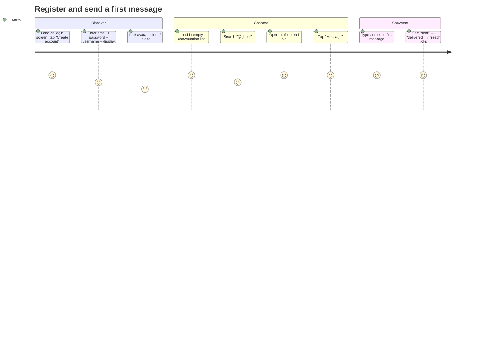

# Product Design

## 1. Product concept

**One-liner.** A fast, private-by-default messenger where you talk to people as `@yourname` — not as
your email address.

**The problem.** Mainstream messengers are tied to a phone number or an email address, which is a
durable, cross-service identity. People who want to discuss a topic, ask a question, join a
community or just chat without permanently attaching their legal identity have no good option:
forums are public and searchable, and phone-number messengers leak a personal identifier with every
contact.

**The product.** Users create an account with an email address (used **only** for authentication and
password recovery) and interact publicly through a pseudonymous profile: `@username`, display name,
avatar, bio. Messages are real-time, persistent and delivered per-device. Privacy controls decide who
sees activity, who can start a chat, and who can find the profile.

### Pseudonymity, not anonymity — and we say so

| | This product | Full anonymity | Mainstream messenger |
| --- | --- | --- | --- |
| Private account identity | email (never shown to users) | none | phone/email (visible to contacts) |
| Public identity | `@username` + display name | none / throwaway | phone number |
| Account recovery | possible | impossible | possible |
| Moderation & abuse handling | reports + server-side enforcement | impractical | reports |
| Message storage | server-side, plaintext at rest | client-only | server-side, plaintext at rest |

We are explicit with users (onboarding + settings + `docs/security-design.md`): pseudonymity protects
them from *casual* identification by other users. It is not anonymity against a determined
adversary, and it is not end-to-end encryption (roadmap item, see [roadmap.md](roadmap.md)).

## 2. Target users

| Persona | Context | Needs | Product answer |
| --- | --- | --- | --- |
| **Aarav, 21, student** | Wants to ask course-mates questions without sharing his phone number | Fast signup, search by username, works on a laptop and phone | 60-second registration, username search, responsive web UI |
| **Mei, 27, hobby community organiser** | Runs a drawing group; people know her by a handle, not her name | Stable handle, profile with bio and links-in-text, notifications that can be muted | Unique `@username`, bio, per-conversation mute, notification preferences |
| **Tomas, 34, privacy-conscious professional** | Will not install an app that asks for his address book; wants to control visibility | Online-status control, blocking, clear data policy | `showOnlineStatus`, `showLastSeen`, `allowMessagesFrom`, block/unblock, honest security doc |
| **Nadia, 19, first-time user, mobile-first** | Uses a 4-year-old Android phone on slow data | Light bundle, no layout thrash, offline-tolerant | ≤ 350 KB gzipped bundle, optimistic UI, reconnect states, single-pane mobile layout |

## 3. Core user journeys

### J1 — First 60 seconds (register → first message)

Success criteria: registration to first delivered message in **under 90 seconds**, with no email
verification blocking the flow (verification is a roadmap item; see [roadmap.md](roadmap.md#1-near-term)).

### J2 — Returning user, unread backlog

Open app → session cookie still valid → conversation list ordered by recent activity with unread
badges → open the top conversation → history renders instantly from REST → new messages arrive via
socket → typing indicator shows while the peer composes → sending marks read.

### J3 — Privacy-conscious setup

Settings → Privacy → turn off online status and last seen → set `allowMessagesFrom = CONTACTS` →
conversation list hides activity for the user towards non-contacts; search visibility toggle
explained in plain language.

### J4 — Abuse handling

Receive unsolicited message → Report message (reason + description) → optionally Block → the
conversation disappears from the list for the blocker, the blocked user gets `403 FORBIDDEN` on
send, and their profile details are hidden. The report is queued for moderation; the reported user
is never told.

### J5 — Reconnect after a dropped connection

Mobile network flaps → UI shows "Connection lost · Reconnecting…" → automatic exponential-backoff
reconnect (max 30 s) → on success: re-subscribe, refetch the open conversation, refresh presence →
any messages missed while offline appear with correct ordering and are marked delivered.

## 4. Product principles

1. **Fast beats featureful.** Every interaction has an immediate visual response (optimistic send,
   skeleton loaders). Nothing "hangs".
2. **Private by default, controllable by the user.** Online status and last seen are visible by
   default (they make chat useful) but one toggle away from hidden. Profile-in-search is on by
   default; blocking is one tap.
3. **Minimal surface.** One primary action per screen: *find someone → open conversation →
   communicate*. No feeds, no stories, no engagement mechanics.
4. **Never lie to the user.** Status ticks mean what they say (`sent` = server committed,
   `delivered` = recipient device acknowledged, `read` = recipient read). Error messages state what
   happened and what to do next.
5. **Pseudonymity is honest.** We never imply the system is anonymous or encrypted end-to-end.
6. **Accessible by construction.** Keyboard-first navigation, semantic markup, AA contrast — not
   retrofitted.
7. **Respect the device.** No autoplay, no sound by default, `prefers-reduced-motion` honoured,
   small bundle.

## 5. Feature priorities

### MVP (this release — all implemented)

| Area | Included |
| --- | --- |
| Accounts | Register, login (email or `@username`), logout, logout-all, session list/revoke, password change, password reset, account deletion |
| Pseudonymous profile | Username policy + uniqueness, display name, bio, avatar (URL or generated initials), profile privacy |
| Discovery | User search (username + display name), public profile view, start conversation |
| Conversations | DIRECT conversations, list with last message + unread counts, mute, archive, delete/leave |
| Messaging | Text messages, cursor-paginated history, edit (48 h), soft delete, replies, emoji reactions, timestamps |
| Delivery | `SENT`/`DELIVERED`/`READ` receipts, unread badges, batched read marking |
| Real-time | STOMP over WebSocket, auth at handshake, live delivery, typing indicators, presence, reconnect + resync |
| Privacy | Online/last-seen visibility, search visibility, `allowMessagesFrom`, block/unblock list, read-receipt toggle |
| Moderation | Report user/message, moderation states, audit trail, rate limits |
| Notifications | In-app records, real-time delivery, unread state, type preferences, 90-day retention |
| Quality | Light/dark/system theme, responsive 1/2/3-pane layouts, empty/loading/error/offline states, WCAG 2.1 AA |

### Next (post-MVP, ordered)

1. Email verification + account recovery hardening.
2. Attachments (image/file) with object storage + server-side validation + signed URLs.
3. Group conversations (`GROUP`) — the schema and access layer are already conversation-type
   agnostic.
4. Message search within a conversation (`pg_trgm` → OpenSearch when needed).
5. Push notifications (Web Push first, then mobile).
6. E2EE research track using established protocols only (see roadmap).

### Explicitly not doing

- A feed, follower graph, or public channel discovery (this is a messenger, not a social network).
- Voice/video calls (WebRTC infrastructure is out of scope).
- Custom cryptography, "self-destructing" messages without a threat model, or claims of anonymity.
- Bots/platform API in this version.

## 6. Metrics that would tell us the product works

| Metric | Definition | Target |
| --- | --- | --- |
| Time-to-first-message | Register → first delivered message | < 90 s median |
| First-week retention | Users sending ≥ 1 message in week 1 after registering | > 35 % |
| Realtime reliability | Sockets that reconnect successfully after a drop | > 99 % |
| Message success rate | Sends that reach `SENT` on the first attempt | > 99.5 % |
| Read-receipt usefulness | Conversations where a message reaches `READ` | > 60 % |
| Privacy adoption | Users changing ≥ 1 privacy default | trended, not targeted |

No dark patterns: we do not nag users to re-enable notifications, we do not default to "everyone
can message me" *and* hide the setting, and we never send "someone mentioned you" emails for
messages the user has already read.

## 7. Competitive positioning (why the trade-offs are chosen)

| | Telegram | Signal | WhatsApp | **This product** |
| --- | --- | --- | --- | --- |
| Identity | phone (+ optional username) | phone | phone | **email (private) + username (public)** |
| E2EE | only secret chats | default | default | **no (documented, roadmap)** |
| Account recovery | yes | limited | yes | **yes (email)** |
| Multi-device sessions | yes | yes | limited | **yes (cookie sessions, revocable)** |
| Web-first, zero-install | yes | no | limited | **yes** |
| Self-hostable | no | no | no | **yes (docker compose)** |

The differentiator is *identity model + web-first simplicity*, not cryptographic guarantees. Being
explicit about that is part of the product.
