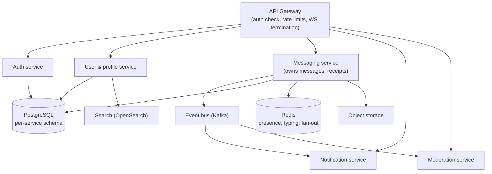

# Roadmap

Ordered by value ÷ effort, with explicit entry criteria so that "later" does not mean "vague".
Everything listed here is **out of scope for the current release** and is documented rather than
half-implemented.

---

## 1. Near term (next 1–2 iterations)

| # | Item | Why | Entry criteria | Sketch |
| --- | --- | --- | --- | --- |
| 1 | **Email verification** | Reduces spam registrations and makes account recovery trustworthy | SMTP configured | `email_verified` + `verification_tokens` table; unverified accounts limited to 20 messages/day; resend endpoint with rate limit |
| 2 | **Message search inside a conversation** | Users need to find an old link/address | `pg_trgm` already enabled | `GET /conversations/{id}/messages/search?q=` with a GIN index on `content`; scoped to conversations the user participates in; results paginated by relevance then time |
| 3 | **Attachments (image/file)** | The most requested missing feature | Object storage (S3/MinIO) available | `POST /attachments` presigned upload → `attachments` row → `message_type=IMAGE|FILE`; server-side MIME/size validation, magic-byte sniffing, EXIF stripping, antivirus hook, signed download URLs |
| 4 | **Group conversations** | Natural extension; schema is already `type`-aware | Membership roles defined | `GROUP` conversations with `conversation_participants.role` (`OWNER`/`ADMIN`/`MEMBER`), system messages for joins/leaves, per-group notification defaults |
| 5 | **Push notifications** | Mobile users are not always in the tab | VAPID keys, service worker | Web Push with the Notifications API, per-type preferences already modelled, deduplicated against in-app reads |
| 6 | **Account data export** | Data-portability requirement (`NFR-D-4`) | — | `GET /users/me/export` → signed, expiring download of a JSON archive (profile, conversations, messages) generated in a background job |

---

## 2. Microservice decomposition path

Only worth doing when a *specific* module hits an independent scaling or ownership constraint.
The monolith is deliberately structured so the first two extractions are mechanical.

### Extraction order and rationale

| Step | Extract | Trigger | What has to change |
| --- | --- | --- | --- |
| 0 | **WebSocket gateway** (not a service, a deployment) | > ~20 k concurrent sockets | STOMP broker relay; the gateway becomes stateless; fan-out already goes through Redis |
| 1 | **Notifications** | Notification fan-out contends with message latency | Already isolated behind `NotificationPublisher` + after-commit async; add Kafka consumer, own schema |
| 2 | **Moderation** | Compliance/ownership boundary | Admin API + audit tables move; report creation becomes an event |
| 3 | **Messaging** | Independent write scaling | Requires an outbox + saga for "create message + update conversation ordering"; this is the expensive one, so it comes last |
| 4 | **Auth** | Security/compliance boundary | Session validation becomes an API call or a short-lived signed token; revocation needs a shared store |

Guardrails that keep this possible today:

- module-private repositories (no cross-module SQL joins outside documented projections),
- identifiers instead of cross-module JPA relationships,
- after-commit domain events as the integration seam,
- `publishAfterCommit` is the future **transactional outbox** insertion point (see §3).

---

## 3. Event bus and outbox

Today, events are in-process (`SpringDomainEventPublisher`) plus Redis Pub/Sub for fan-out. That is
correct for a monolith but has one gap for multi-module extraction: an event can be lost if the
process dies between commit and publish.

**Plan:** add an `outbox_events` table written **inside** the same transaction as the aggregate
change, plus a relay (polling or Debezium CDC) that publishes to Kafka and marks rows delivered.
Consumer-side idempotency via `(aggregate_id, event_type, version)`.

| Aspect | Current | Target |
| --- | --- | --- |
| Delivery | at-most-once (in-process / Redis) | at-least-once + idempotent consumers |
| Ordering | per-connection | per-partition keyed by `conversation_id` |
| Replay | none | Kafka retention + consumer offsets |
| Schema evolution | Java records | Avro/JSON Schema with a registry |

---

## 4. Scale targets and the work each one implies

| Milestone | Users | Sockets | Messages/day | Work required |
| --- | --- | --- | --- | --- |
| Current | ≤ 5 k | ≤ 2 k | ≤ 1 M | single instance + Postgres + Redis |
| **M1** | 25 k | 10 k | 10 M | 2–3 stateless instances, broker relay, read replica for history, monthly partitioning of `messages` |
| **M2** | 250 k | 100 k | 100 M | dedicated WS gateway fleet, Kafka, per-domain schemas, OpenSearch for search, S3 + CDN for media, autoscaling + load shedding |
| **M3** | 2 M+ | 1 M | 1 B | multi-region presence (regional Redis + inter-region gossip), tiered storage (hot Postgres / cold object store), sharded messaging by conversation hash |

Concrete database work per milestone: M1 `PARTITION BY RANGE (created_at)` on `messages` and
`message_receipts` with automatic partition creation; M2 archive partitions older than 90 days to
Parquet in object storage with an FDW/Athena-style query path; M3 conversation-hash sharding with a
routing table.

---

## 5. Version upgrade path

| From | To | Blocking work |
| --- | --- | --- |
| Spring Boot 3.5.x (current) | 4.x (Jackson 3, Spring Security 7, JUnit 6) | (1) swap Jackson 2 annotations — the DTO layer avoids them by design, so this is mostly dependency work; (2) verify starter names (`spring-boot-starter-webmvc` et al.) and migrate `pom.xml`; (3) Security 7 DSL review (`authorizeHttpRequests`, CSRF, session config); (4) JUnit 6 upgrade of imports; (5) re-run the full integration + E2E suite against Testcontainers images pinned to PostgreSQL 16 |
| Java 21 | 25 (LTS) | None expected; virtual threads (`spring.threads.virtual.enabled=true`) can replace the bounded executor for notification work — measure before enabling |
| PostgreSQL 16 | 17/18 | `pg_upgrade` in a staging restore; verify `pg_trgm`/`citext` availability and index rebuild time |

Rule: upgrade one major line at a time, run `./mvnw verify` + Playwright E2E against the new stack,
and keep the previous minor release deployable for one cycle.

---

## 6. End-to-end encryption roadmap

Detail lives in [security-design.md](security-design.md#8-end-to-end-encryption-roadmap-not-implemented).
Summary of the required preconditions before any E2EE code is written:

1. A maintained, audited protocol implementation is chosen (**X3DH + Double Ratchet** via
   `libsignal` or an equivalent) — **no custom cryptography, ever**.
2. Multi-device key management and safety-number verification UX are designed.
3. Server-side search is replaced by client-side search over the local cache.
4. Moderation has a client-side reporting path (the server cannot read reported content).
5. Key-transparency mechanism chosen to detect a malicious server.
6. Capability negotiation and dual-write migration plan for existing plaintext history.

Until all six are satisfied, the product does not use the word "encrypted" about message contents.

---

## 7. Deliberately rejected ideas

| Idea | Why rejected |
| --- | --- |
| Blockchain/"immutable" message log | Adds latency and cost, solves no user problem here |
| Custom crypto ("we encrypt with AES + our own key exchange") | Textbook footgun; violates the project's security principle |
| Microservices from day one | Distributed transactions for a chat MVP; operational cost with no benefit at this scale |
| GraphQL instead of REST+WS | The client needs cursors and a socket, not flexible query shapes; REST keeps caching and OpenAPI simple |
| Storing typing/presence in PostgreSQL | Write amplification on the hottest path for data that is inherently ephemeral |
| Storing the session token in `localStorage` | XSS-exfiltratable; the cookie model with CSRF protection is strictly better |

---

## 8. Quality goals for the next release

| Goal | Metric | Current |
| --- | --- | --- |
| Backend coverage | ≥ 80 % lines on services | see CI report |
| Frontend coverage | ≥ 60 % overall, ≥ 80 % on services/websocket | see CI report |
| E2E suite duration | < 5 min | measured in CI |
| p95 message delivery | < 300 ms | see `tests/performance` |
| Dependency freshness | no critical CVEs; majors ≤ 1 behind | Dependabot + dependency review in CI |
| Documentation | every endpoint, event and table documented and diff-checked in CI | enforced by `tools/verify` |
