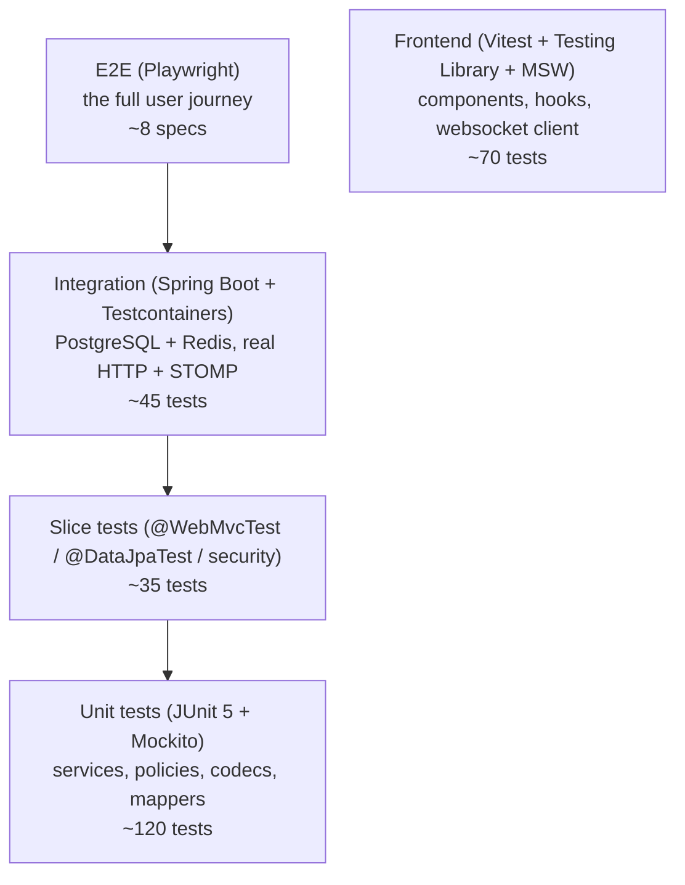

# Testing Strategy

Test pyramid with a **mandatory end-to-end journey**. Every module has tests for its happy path,
its failure modes and its authorization decisions.

---

## 1. Layers



| Layer | Tooling | Runs against | Command |
| --- | --- | --- | --- |
| Unit | JUnit 5, Mockito, AssertJ | no infrastructure | `cd backend && ./mvnw test` |
| Slice | `@WebMvcTest`, `@DataJpaTest`, `spring-security-test` | PostgreSQL (Testcontainers) for JPA slices | `./mvnw test` |
| Integration | `@SpringBootTest(webEnvironment = RANDOM_PORT)` + `Testcontainers` + `@ServiceConnection`; `WebSocketStompClient` | real PostgreSQL + Redis containers | `./mvnw verify` |
| E2E | Playwright (Chromium + Mobile Safari emulation) | full stack via `docker compose` | `npx playwright test` (see `tests/e2e`) |
| Performance | k6-style script + WebSocket load harness | full stack | `tests/performance/README.md` |

Failsafe is bound to `verify` for `*IT` classes; Surefire runs `*Test`. Integration tests are tagged
`@Tag("integration")` so `./mvnw test -DexcludedGroups=integration` gives a fast local loop.

---

## 2. Backend test inventory

### 2.1 Authentication (`auth`)

| Test | Type | Asserts |
| --- | --- | --- |
| `AuthServiceTest#register_hashesPasswordWithArgon2id` | unit | stored hash starts with `$argon2id$`, never equals the raw password |
| `AuthServiceTest#register_rejectsDuplicateEmail/Username` | unit | `EmailTaken`/`UsernameTaken` |
| `AuthServiceTest#register_isCaseInsensitiveForEmailAndUsername` | unit | `Ghost@Example.test` collides with `ghost@example.test` |
| `AuthServiceTest#login_acceptsEmailOrUsername` | unit | both identifiers work |
| `AuthServiceTest#login_sameErrorForUnknownUserAndWrongPassword` | unit | identical exception type + message |
| `AuthServiceTest#login_locksAccountAfterRepeatedFailures` | unit | soft lock with `lockedUntil` |
| `AuthServiceTest#changePassword_revokesOtherSessions` | unit | repository calls + session rotation |
| `PasswordResetServiceTest#consumedTokenCannotBeReused` | unit | single-use enforcement |
| `PasswordResetServiceTest#expiredTokenRejected` | unit | 30-minute TTL |
| `PasswordPolicyTest` (parameterized) | unit | length, deny-list, username/email substring rules |
| `AuthControllerIT` | integration | register → 201 + cookies + `Location`; duplicate → 409; bad body → 400 with field details; login → 200; `me` → 200; logout → 204 and cookie cleared |
| `SessionServiceIT` | integration | create/validate/expire/revoke, sliding expiry, Redis cache invalidation on revoke |
| `CsrfProtectionIT` | integration | `POST /auth/login` without token → 403; with token → 200 |
| `AuthRateLimitIT` | integration | 11th login attempt in the window → 429 with `Retry-After` |
| `AccountDeletionIT` | integration | account gone, sessions gone, messages anonymised, email reusable afterwards |

### 2.2 Users, profiles, privacy

| Test | Type | Asserts |
| --- | --- | --- |
| `UsernamePolicyTest` | unit | normalization, length, charset, underscore rules, reserved words, profanity list |
| `ProfileMapperTest` | unit | `PublicProfileResponse` never contains `email`/`passwordHash` (assertion over serialized JSON) |
| `ProfileSearchIT` | integration | prefix and fuzzy matches, case-insensitivity, `showProfileInSearch=false` excluded, cursor pagination is stable across inserts, limit enforcement |
| `PrivacyServiceIT` | integration | `showOnlineStatus=false ⇒ showLastSeen=false`; `allowMessagesFrom=CONTACTS` blocks new conversations; read-receipt suppression |
| `BlockEnforcementIT` | integration | (a) blocked user cannot send, (b) blocker cannot send either, (c) conversation creation blocked both ways, (d) profile fetch → 404, (e) typing/presence suppressed, (f) unblock restores |
| `PresencePrivacyIT` | integration | `HIDDEN` emitted when a user disables online status mid-session; `lastSeenAt` rounded and only for `OFFLINE` |

### 2.3 Conversations & messaging

| Test | Type | Asserts |
| --- | --- | --- |
| `ConversationServiceTest` | unit | DIRECT idempotency via `direct_key`, self-conversation rejected, block checks |
| `ConversationAccessServiceTest` | unit | non-participant → `NotFound` (not `Forbidden`) |
| `ConversationListIT` | integration | ordering by `last_activity_at`, unread counts correct, muted/archived filtering, **query count ≤ 2 for a 50-row page** (N+1 guard) |
| `MessageServiceTest` | unit | validation, edit window (48 h), ownership, tombstone behaviour, block enforcement inside the transaction |
| `MessagePersistenceIT` | integration | commit-before-publish ordering; a rolled-back send emits no event |
| `MessageIdempotencyIT` | integration | duplicate `clientMessageId` returns the stored message with `Idempotent-Replay: true` and no second row (verified by `count(*)`) |
| `MessageHistoryIT` | integration | cursor pagination correctness with identical timestamps, `hasMore`, no `OFFSET` in generated SQL (`EXPLAIN` assertion), index usage on `(conversation_id, created_at DESC, id DESC)` |
| `MessageAuthorizationIT` | integration | outsider: read → 404, send → 404, edit → 403/404, delete → 403/404, react → 404 |
| `ReceiptServiceIT` | integration | SENT → DELIVERED → READ monotonicity; stale acks cannot regress; batched read update affects only unread rows |
| `ReactionServiceIT` | integration | toggle idempotency, aggregation, allow-list rejection |
| `MessageEditDeleteIT` | integration | `editedAt` set, content nulled on delete, reply parent becomes a tombstone but stays addressable |
| `MessageValidationIT` | integration | empty/whitespace-only, 4 001 chars, control characters, `IMAGE` type → `UNSUPPORTED_MESSAGE_TYPE` |

### 2.4 Realtime

| Test | Type | Asserts |
| --- | --- | --- |
| `WebSocketAuthIT` | integration | no cookie → upgrade rejected 401; foreign `Origin` → 403; valid → `CONNECTED` with `user-name` |
| `WebSocketSubscriptionIT` | integration | subscribing to another user's conversation topic → `ERROR` frame, no subscription |
| `ChatWebSocketIT` | integration | two authenticated sessions; A sends → A receives `message.ack`, B receives `message.new` (within 2 s); persisted row matches the frame |
| `TypingIndicatorIT` | integration | typing is delivered to the peer only, expires after TTL, and **writes nothing to PostgreSQL** (asserted by querying `messages`/any table for typing traces) |
| `PresenceServiceIT` | integration | connect → `ONLINE` to contacts; multi-tab count; last disconnect → `OFFLINE` + throttled `last_seen_at`; Redis key TTL present |
| `ReadReceiptIT` | integration | B marks read → A receives `message.read.updated` with the right message ids |
| `ReconnectResyncIT` | integration | client disconnects, a message is sent meanwhile, client reconnects and resyncs via `afterSequence` → no lost or duplicated messages |
| `SlowConsumerIT` | integration | a stalled socket is disconnected (`1008`) instead of blocking fan-out |
| `SessionRevocationIT` | integration | logout-all → other sessions receive `session.revoked` and subsequent requests are 401 |

### 2.5 Notifications & moderation

| Test | Type | Asserts |
| --- | --- | --- |
| `NotificationServiceTest` | unit | mute/preference/sender-self suppression rules; preview truncation to 120 chars |
| `NotificationDeliveryIT` | integration | message → notification row + realtime event; failure of the notification path does not break the message transaction (async, after-commit) |
| `NotificationApiIT` | integration | list, cursor, mark-read (own rows only), clear, settings update |
| `ReportServiceTest` | unit | self-report rejected, duplicate active report rejected, reason enum validation |
| `ReportControllerIT` | integration | report message/user, 201, rate limit, reporter anonymity (no notification to target), admin transition writes history |
| `ModerationAuthIT` | integration | non-admin cannot read the queue or change status |

### 2.6 Cross-cutting & architecture

| Test | Type | Asserts |
| --- | --- | --- |
| `GlobalExceptionHandlerIT` | integration | every error code produces the documented envelope; 500 leaks no stack trace/SQL |
| `OpenApiContractIT` | integration | `/v3/api-docs` contains every documented path and no `email` field in public schemas |
| `ArchitectureTest` | unit (reflection-based) | controllers do not access repositories directly; `*.entity` is not referenced from another module's `service`; no `java.util.Random` in security code |
| `QueryCountTest` | integration (Hibernate statistics) | conversation list ≤ 2 queries, message page ≤ 2 queries |

---

## 3. Frontend test inventory (Vitest + Testing Library + MSW)

| Area | Tests |
| --- | --- |
| `apiClient` | attaches `X-XSRF-TOKEN` from the cookie, maps error envelopes to typed errors, retries idempotent GETs on network failure, `401` clears auth state |
| `stompClient` | state machine transitions, exponential backoff with jitter (fake timers), resubscription after reconnect, resync callback ordering, no auto-retry on `401` |
| Auth UI | validation messages, submit disabled while pending, error banner on 401, success → redirects, password visibility toggle, ARIA roles |
| Onboarding | username availability feedback, policy hints, required fields, privacy summary |
| Conversation list | skeleton on load, empty state copy, rows render name/preview/time/unread, typing replaces preview, error + retry, offline banner |
| Message list | renders own/other bubbles, day dividers, reply quotes, tombstones, status icons per state (`SENDING/SENT/DELIVERED/READ/FAILED`), retry action, `role="log"` accessibility attributes |
| Composer | Enter sends, Shift+Enter newline, empty disabled, emoji picker inserts, draft persists per conversation, max length guard |
| Search | debounce, empty-result copy, rate-limit message, keyboard navigation of results |
| Profile | renders public fields only (asserts absence of email), block button flow with confirmation, report dialog validation |
| Settings | privacy toggles call the API and reflect optimistic state, theme switch (light/dark/system) persists locally, blocked list unblock |
| Responsive | list↔chat navigation at < 768 px, back button behaviour, three-pane at ≥ 1024 px (matchMedia mock) |
| Reconnection UX | banner text per state, queued sends flush after reconnect with the same `clientMessageId` |

Coverage target: ≥ 80 % lines on `services/`, `websocket/`, `state/`, `hooks/` and ≥ 60 % overall
(enforced by `npm run test:coverage` thresholds in `vitest.config.js`).

---

## 4. End-to-end scenario (mandatory)

`tests/e2e/full-conversation-journey.spec.js` — Playwright, two isolated browser contexts:

```
1  User A registers (unique email/username per run)
2  User B registers (second context)
3  A searches for B's username
4  A opens B's public profile
5  A starts a conversation and sends "Hey Bob!"
6  B receives it over the WebSocket *without reloading* (assertion on DOM text + no navigation)
7  B replies "Hey Alice!"
8  A receives the reply in real time
9  B marks the conversation read (opens it)
10 A sees the read receipt (aria-label "read") on their message
11 A edits the message; B sees "edited" 
12 A deletes it; B sees the tombstone
13 B blocks A; A's send fails with the blocked message and no bubble leaves SENDING/FAILED
14 Reload both contexts: history, ordering and unread badges are correct (persistence check)
```

Additional specs: `auth-flows.spec.js` (register/login/logout/password reset with a mail sink,
session revocation), `privacy-and-blocking.spec.js`, `reconnect.spec.js` (kill the WebSocket via
`page.route`, assert the banner and recovery), `responsive-navigation.spec.js` (mobile viewport),
`accessibility.spec.js` (axe scan on the main screens; no serious/critical violations).

Run:

```bash
docker compose up -d          # full stack
cd tests/e2e && npm install
npx playwright install --with-deps
npx playwright test            # BASE_URL default http://localhost:8080
```

---

## 5. Performance tests

`tests/performance/` contains a documented harness (`README.md` + scripts):

| Scenario | Shape | Pass criteria |
| --- | --- | --- |
| REST read | 200 VU, 60 s: conversation list + message page | p95 < 150 ms, 0 errors |
| Message send | 50 users × 6 msg/s for 5 min | p95 server commit < 100 ms, no duplicates, receipts consistent |
| WebSocket fan-out | 2 000 idle sockets, 200 msg/s to 200 conversations | p95 delivery < 300 ms, memory stable (±10 %) |
| Reconnect storm | 2 000 clients reconnect within 10 s | no 5xx, backoff prevents thrash, recovery < 30 s |
| History depth | conversation with 100 000 messages | first page < 100 ms, older pages use the index (no sequential scan) |

SQL-level checks are part of the integration suite: `EXPLAIN (ANALYZE, BUFFERS)` assertions for the
two hottest queries (conversation list, message page) fail the build if a sequential scan appears.

---

## 6. What was verified where

Honest record of what was actually executed while building this repository, and what requires a
normal development environment.

| Artifact | Verification available in the authoring sandbox | Result |
| --- | --- | --- |
| `database/migrations/*.sql` | executed end-to-end against a **real PostgreSQL 16.2 server**, plus parsing with `pglast` (PostgreSQL's own lexer/parser) | ✅ all migrations applied cleanly; constraints/indexes/triggers created |
| `database/seed/dev_seed.sql` | executed against the same server after the migrations | ✅ idempotent, requires an explicit seed password |
| Frontend | `npm install`, `npm run build`, `npm test` (Vitest + Testing Library, jsdom), `npm run lint` | ✅ production build succeeds; unit/integration tests pass |
| Java backend | `tools/verify/java_static_check.py` — parse every file with a real Java grammar (`tree-sitter-java`), then check cross-file symbol resolution, package/directory agreement, REST endpoint coverage against `docs/api-specification.md`, and security anti-patterns | ✅ no syntax errors, all internal references resolve, all documented endpoints present |
| Java compile/run, Testcontainers, Playwright E2E | **not executed here** — the sandbox has no Maven Central access (no `javac`/dependencies) and no Docker daemon | ⛔ documented; commands are provided in [deployment.md](deployment.md) |

The sandbox limitation is an environment constraint, not a design decision: the repository is
structured so that `./mvnw verify` (with Docker available for Testcontainers) and `npx playwright test`
run the full suites unchanged on a normal machine.

---

## 7. Test data & fixtures

- **No shared mutable state**: integration tests use `@Transactional` rollback where possible, and
  otherwise create uniquely-named users (`user_{uuid8}`) so tests can run in parallel.
- **Factories**: `TestUsers.aUser().withUsername("ghost")`, `TestMessages.inConversation(...)` —
  readable fixtures instead of long constructors.
- **Clock control**: `TimeProvider` is injected; tests use `MutableTimeProvider` to exercise the
  48-hour edit window, token expiry, sliding sessions and `last_seen` throttling deterministically.
- **No production data in tests**; no test data in production (seed runs only under the `dev` profile
  and refuses to run without `seed_password`).

---

## 8. CI pipeline (`.github/workflows/ci.yml`)

```
1  backend:   ./mvnw -B verify            (unit + slice + integration with Testcontainers)
2  frontend:  npm ci && npm run lint && npm run test -- --coverage && npm run build
3  security:  dependency review + secret scan (gitleaks) + java static check
4  e2e:       docker compose up -d --build && npx playwright test   (after 1–3 pass)
5  artifacts: coverage reports, Playwright traces/screenshots on failure
```

Branch protection requires 1–4 green before merge; migrations are checked for forward-only intent by
a policy job that rejects edits to existing `V*__` files (Flyway checksums would break anyway).
