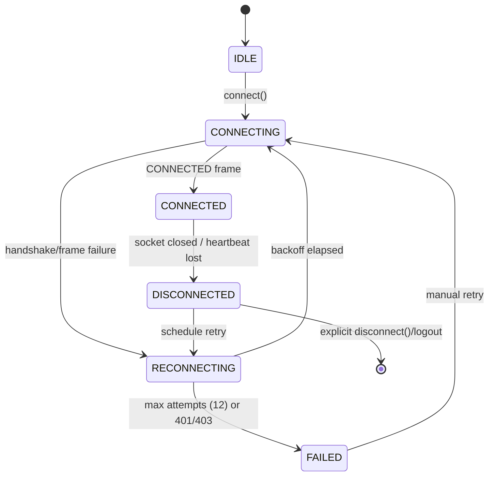

# WebSocket Protocol

STOMP 1.2 over native WebSocket · Endpoint `wss://<host>/ws` · Message body: JSON (UTF-8) ·
Heartbeat: server `10000,10000` (10 s) · Frame size limit: 16 KiB.

The socket is a **low-latency transport for deltas**. PostgreSQL remains the source of truth;
anything a client must not lose is recovered through REST after (re)connecting.

---

## 1. Connection & authentication

1. The client opens a WebSocket to `/ws` **with credentials** (the `HttpOnly` `session` cookie is
   sent by the browser automatically for same-origin connections).
2. `WebSocketAuthHandshakeInterceptor` resolves the session (Redis cache → `user_sessions`).
   - missing/expired → the upgrade is rejected with **HTTP 401** and the socket never opens.
   - `Origin` header not in the configured allow-list → rejected with **HTTP 403**.
3. The client sends a STOMP `CONNECT` frame. A `ChannelInterceptor` binds the resolved identity to the
   STOMP session and stamps `sessionAttributes[userId]`, `username`, `sessionId`.
   - No `CONNECT` within 10 seconds → the session is closed.
4. The server replies `CONNECTED` with headers `version:1.2`, `heart-beat:10000,10000`,
   `user-name:<userId>`.

**Client → server frames never carry an identity.** `userId` in any payload is ignored (and logged as
a protocol violation). Authorization always derives from the STOMP session.

### Subscriptions (client → server `SUBSCRIBE`)

| Destination | Who may subscribe | Delivers |
| --- | --- | --- |
| `/user/queue/messages` | any authenticated user | message lifecycle events addressed to them |
| `/user/queue/events` | any authenticated user | presence, typing, conversation, notification events |
| `/user/queue/errors` | any authenticated user | per-command failures |
| `/topic/conversation/{conversationId}` | participants of that conversation only (checked in a `SUBSCRIBE` interceptor; otherwise `ERROR` + no subscription) | conversation-scoped events (typing, read) |

---

## 2. Event catalogue

### 2.1 Client → server (application destinations)

| Event (`destination`, `type`) | Purpose | Payload |
| --- | --- | --- |
| `SEND /app/chat.send` | Send a message | `{ conversationId, content, clientMessageId, messageType?, replyToMessageId? }` |
| `SEND /app/chat.delivered` | Acknowledge receipt of messages | `{ conversationId, lastMessageId }` |
| `SEND /app/chat.read` | Mark conversation read | `{ conversationId, lastMessageId }` |
| `SEND /app/chat.typing` | Typing started/stopped | `{ conversationId, isTyping }` |
| `SEND /app/message.edit` | Edit own message | `{ messageId, content, clientMessageId? }` |
| `SEND /app/message.delete` | Delete own message | `{ messageId, clientMessageId? }` |
| `SEND /app/message.reaction` | Toggle reaction | `{ messageId, emoji, clientMessageId? }` |

All client commands are **idempotent-friendly**: `clientMessageId` (UUID) is echoed in the
acknowledgement so the client can reconcile its optimistic entry.

### 2.2 Server → client

| Event (`type`) | Destination | Purpose | Payload |
| --- | --- | --- | --- |
| `message.ack` | `/user/queue/messages` | The sender's own message was committed | `{ clientMessageId, message: MessageDto }` |
| `message.new` | `/user/queue/messages` | A new message arrived (recipients) | `{ message: MessageDto }` |
| `message.updated` | `/user/queue/messages` | Edit applied | `{ message: MessageDto }` |
| `message.deleted` | `/user/queue/messages` | Deleted (tombstone) | `{ messageId, conversationId, deletedAt }` |
| `message.delivered` | `/user/queue/messages` | Recipient acknowledged | `{ conversationId, recipientId, lastMessageId, deliveredAt }` |
| `message.read.updated` | `/user/queue/messages` | Recipient read | `{ conversationId, readerId, lastMessageId, readAt }` |
| `message.reaction.updated` | `/user/queue/messages` | Reaction added/removed (aggregated) | `{ messageId, conversationId, reactions: [{ emoji, count, reactedByMe }] }` |
| `message.failed` | `/user/queue/errors` | Command rejected | `{ clientMessageId?, code, message }` |
| `typing.started` / `typing.stopped` | `/user/queue/events` and `/topic/conversation/{id}` | Typing state (ephemeral) | `{ conversationId, userId, displayName, expiresInMs }` |
| `presence.updated` | `/user/queue/events` | Contact presence change | `{ userId, status, lastSeenAt? }` |
| `conversation.created` | `/user/queue/events` | Someone started a conversation with you | `{ conversation: ConversationSummaryDto }` |
| `conversation.updated` | `/user/queue/events` | Mute/archive/last-message/unread change | `{ conversationId, unreadCount?, muted?, archived?, lastMessage? }` |
| `notification.new` | `/user/queue/events` | In-app notification created | `{ notification: NotificationDto, unreadCount }` |
| `session.revoked` | `/user/queue/events` | Session(s) ended elsewhere → client must clear state and route to `/login` | `{ reason }` |

### 2.3 Payload schemas

`MessageDto` (identical to the REST representation — one renderer on the client):

```json
{
  "id": "c3d4…",
  "conversationId": "e9f1…",
  "senderId": "8f1a…",
  "content": "Hey!",
  "messageType": "TEXT",
  "clientMessageId": "7b2f…",
  "sequence": 10455,
  "replyTo": { "id": "…", "senderId": "…", "preview": "…", "deleted": false },
  "reactions": [{ "emoji": "😂", "count": 2, "reactedByMe": true }],
  "receipt": { "status": "SENT", "deliveredAt": null, "readAt": null },
  "editedAt": null,
  "deletedAt": null,
  "createdAt": "2026-09-22T10:42:11.000Z",
  "updatedAt": "2026-09-22T10:42:11.000Z"
}
```

`MessageDto.receipt.status` is from the **caller's** perspective: for the sender it is the aggregate
recipient status (`SENT` until the recipient acknowledges, then `DELIVERED`, then `READ`); for a
recipient it is their own receipt.

**Watermarks, not id lists.** `message.delivered` and `message.read.updated` carry a single
`lastMessageId` watermark rather than an array of ids. A user returning after a week can be behind
thousands of messages, and a per-message list would make the frame grow with the backlog (and could
exceed the 16 KiB frame limit). Clients apply the watermark by marking every message they hold in that
conversation that is at or before the watermark. The server computes the watermark itself from the
receipt rows, so a client can never acknowledge a message it was not sent.

### 2.4 Example exchange

```
CLIENT → SERVER   SEND /app/chat.send
                  {"conversationId":"e9f1…","content":"Hey!","clientMessageId":"7b2f…"}
SERVER → CLIENT   MESSAGE /user/queue/messages
                  {"type":"message.ack","clientMessageId":"7b2f…","message":{…,"status":"SENT"}}
SERVER → RECIPIENT /user/queue/messages
                  {"type":"message.new","message":{…,"status":"SENT"}}
RECIPIENT → SERVER SEND /app/chat.delivered
                  {"conversationId":"e9f1…","lastMessageId":"c3d4…"}
SERVER → SENDER   MESSAGE /user/queue/messages
                  {"type":"message.delivered","conversationId":"e9f1…","messageIds":["c3d4…"]}
```

---

## 3. Server-side handling rules

1. **Authorize first.** Every command resolves the authenticated user and verifies participation via
   `ConversationAccessService`. Failures return `message.failed` with `NOT_FOUND` (never revealing
   whether the conversation exists).
2. **Persist before broadcasting.** Nothing is emitted until the transaction commits
   (`DomainEventPublisher.publishAfterCommit`). A socket write is never treated as storage.
3. **Block enforcement.** Send/typing/reaction commands check blocks in both directions and fail with
   `BLOCKED`.
4. **Validation** mirrors REST: content 1–4000 chars, types restricted, emoji from the allow-list,
   `conversationId`/`messageId` must be UUIDs.
5. **Rate limiting.** Per-user token buckets on `chat.send` (30/min, burst 10) — exceeded commands get
   `RATE_LIMITED` on `/user/queue/errors` and are dropped.
6. **Deduplication.** Repeated `clientMessageId` returns the stored message (`message.ack` with
   `replayed: true`) instead of a duplicate.
7. **Backpressure.** Each session has a bounded outbound queue (1 000 frames). Overflow disconnects
   that session with STOMP `ERROR` + close code `1008` rather than delaying other recipients.

---

## 4. Delivery semantics (what is actually guaranteed)

| Guarantee | Provided? | Detail |
| --- | --- | --- |
| Message is durably stored once the sender receives `message.ack` | ✅ | PostgreSQL commit precedes the ack |
| Each recipient receives `message.new` while connected | ✅ (best effort) | Redis Pub/Sub fan-out; a dropped frame is recovered by resync |
| Exactly-once *effect* of a send | ✅ | `clientMessageId` unique index + replay returns the stored row |
| Ordering per conversation as seen by the server | ✅ | Ordering by `(created_at, id)`; clients re-sort on resync |
| Ordering of frames on one TCP connection | ✅ | STOMP/WebSocket preserves order |
| Delivery to an offline user is "retried" by the socket | ❌ | Offline users recover history/pending messages through REST on next load |
| `DELIVERED` means "shown on the recipient's device" | ✅ (bounded) | Set when the recipient's client acknowledges; if the client is closed the state stays `SENT` |
| `READ` means "the recipient opened the conversation" | ✅ | Set by `chat.read`/`POST …/read` |

The UI must therefore never render "Delivered" without an acknowledgement, and never claim
guaranteed delivery (see [requirements.md](requirements.md#15-delivery--read-states-frs)).

---

## 5. Reconnection & resynchronisation

Client state machine (implemented in `frontend/src/websocket/stompClient.js`):



Backoff: `min(30s, 1s × 2^attempt) ± 20 % jitter`, reset on a successful `CONNECTED`.
`401`/`403` during handshake are **not** retried automatically (the session is gone → route to
`/login`).

On every successful (re)connection the client performs, in order:

1. **Re-subscribe** to `/user/queue/messages`, `/user/queue/events`, `/user/queue/errors` and to
   `/topic/conversation/{openConversationId}`.
2. **Resync messages**: `GET /api/v1/conversations/{openId}/messages?afterSequence=<lastKnownSequence>`
   (watermark taken from the highest `sequence` already rendered) and merge by `id`.
   If no watermark is known, reload the newest page.
3. **Resync conversation list**: refetch page 1 of `GET /conversations` so unread counts, last
   messages and reordered rows are correct.
4. **Resync presence**: request presence for the visible conversation's peer
   (`GET /users/{id}/presence`) and let `presence.updated` events take over.
5. **Flush the outbox**: messages that were queued locally during the outage are re-sent with their
   original `clientMessageId` (server deduplicates).

While disconnected the UI shows the reconnecting banner and outgoing messages stay in `SENDING`
state with a "will retry" hint; the composer remains usable (the queue is capped at 50 messages).

---

## 6. Heartbeats & liveness

- Server offers `heart-beat:10000,10000`; clients answer with `0,10000` (they rely on the server's
  pings and send their own every 10 s).
- Missing heartbeats for 30 s ⇒ the server closes the session and marks presence offline (guarded by
  a "last connection per user" check so multi-tab users stay online).
- Client-side: no inbound frame within 25 s ⇒ treat as `DISCONNECTED` and reconnect (guards against
  half-open TCP connections on mobile networks).

---

## 7. Presence events

`presence.updated` is sent only to **relevant contacts** (participants of the user's conversations):

```json
{ "type": "presence.updated", "payload": { "userId": "…", "status": "ONLINE", "lastSeenAt": null } }
```

`status ∈ {ONLINE, AWAY, OFFLINE, HIDDEN}`. `HIDDEN` is emitted for the full lifetime of a session
whose owner disabled online status *after* the peer's client already saw them online — this prevents
"stale green dot" leaks without revealing the change:

```json
{ "type": "presence.updated", "payload": { "userId": "…", "status": "HIDDEN" } }
```

`lastSeenAt` is only included when `showLastSeen` is enabled and the user is `OFFLINE`; it is rounded
to the minute to limit fingerprinting. Typing events are suppressed for blocked pairs and for
conversations where the peer has `readReceipts`/presence hidden are unaffected (typing is a
conversation-scoped signal, not a presence signal).

Client-side, typing indicators expire on their own after `expiresInMs` (default 5 000 ms) even if the
`typing.stopped` frame is lost.

---

## 8. Conversation-scoped topic

`/topic/conversation/{conversationId}` carries only ephemeral conversation events (`typing.*`).
Durable events (`message.*`) go to `/user/queue/messages` so that a user never receives duplicate
copies when subscribed to several conversations, and so that authorization is anchored to the user's
identity rather than to a topic name. Subscription to a topic the user does not participate in is
rejected with a STOMP `ERROR` frame:

```
ERROR
message:FORBIDDEN_SUBSCRIPTION

{"code":"FORBIDDEN","message":"You are not a participant of this conversation"}
```

---

## 9. Error frames

Per-command failures (session stays open):

```json
{ "type": "message.failed", "clientMessageId": "7b2f…", "code": "BLOCKED",
  "message": "You can't message this person." }
```

| `code` | Cause |
| --- | --- |
| `VALIDATION_FAILED` | Missing/oversized/invalid fields |
| `FORBIDDEN` | Not a participant / not the message owner / forbidden subscription |
| `NOT_FOUND` | Unknown conversation or message (or hidden by privacy) |
| `BLOCKED` | A block exists between the users |
| `RATE_LIMITED` | Command bucket exhausted (includes `retryAfterMs`) |
| `CONFLICT` | Duplicate/conflicting state (e.g. duplicate active report context) |
| `UNSUPPORTED` | `IMAGE`/`FILE` message types are not enabled in this version |
| `INTERNAL_ERROR` | Unexpected failure (correlation id included, no internals) |

Protocol-level failures (unparseable frame, missing `CONNECT`, bad destination) produce a STOMP
`ERROR` frame followed by a close with code `1008`; the client treats this as `FAILED` and does not
hot-loop (backoff applies).

---

## 10. Metrics & observability for the realtime path

| Metric | Type | Purpose |
| --- | --- | --- |
| `chat.ws.sessions.active` | gauge | connected sessions |
| `chat.ws.handshake.rejected` | counter (tag `reason`) | auth/origin failures |
| `chat.ws.commands` | counter (tag `type`,`outcome`) | command volume and failure rate |
| `chat.message.fanout.latency` | timer | commit → emit |
| `chat.ws.outbound.queue.depth` | gauge | backpressure |
| `chat.ws.reconnects` | counter | realtime reliability |
